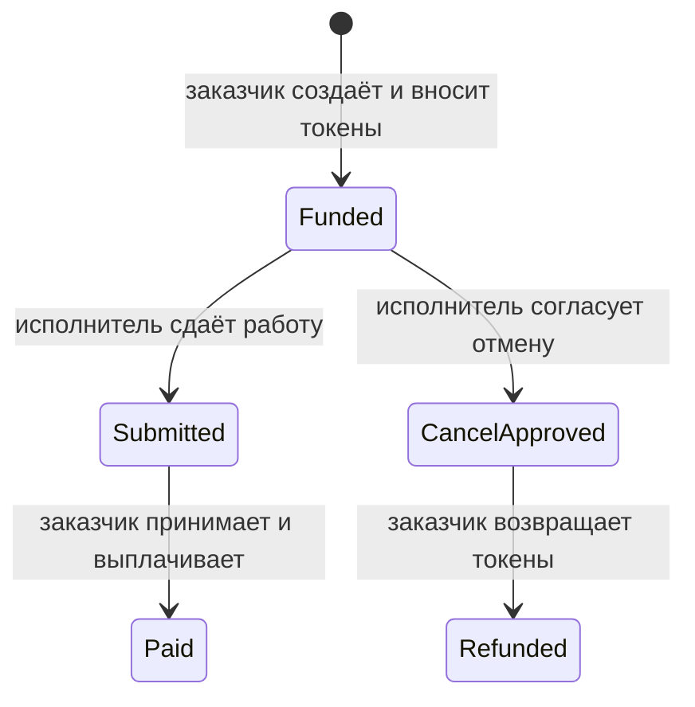

# TrustPay — Decentralized Freelance Escrow

Университетский проект на Solana. Реализованы **недели 8–11**: escrow MVP и реальная DeFi-интеграция Raydium CPMM, проверенная на Devnet. Неделя 10: изолированный Liquidity Vault 1:1 и RPC Dashboard, проверенные реальными Devnet-транзакциями. Неделя 11 добавляет AMM/CLMM-аналитику и проверку композиции CPI. Неделя 12 добавляет Raydium Swap с подтверждёнными Devnet-обменами; исправленная Security Lab проверена на localnet. Ручной swap через Phantom в Chrome подтверждён и проверен в Devnet; неделя 12 завершена. Недели 13–15 не начаты. Только Localnet / Devnet и тестовые SPL-токены. Mainnet не используется.

## Архитектура

- `programs/trustpay`: Anchor 0.31.1, состояние заказа — PDA `["order", client, id_le_u64]`, vault — PDA `["vault", order]` классического SPL Token Program. Заказ создаётся и финансируется атомарно.
- `app`: React + Vite + TypeScript, Phantom через Wallet Adapter. Данные заказов и история их транзакций читаются из RPC. Подписи и приватные ключи остаются в кошельке.
- `tests`: интеграционные тесты реальных транзакций на локальном validator.
- `scripts`: синхронизация сгенерированного Anchor IDL и выпуск локальных тестовых токенов.
- `docs/week08.md`: результаты проверок и отчёт.

## Жизненный цикл



Других переходов нет. Заказчик не может вернуть средства без согласия исполнителя. После сдачи работы отмена недоступна. **Арбитража, таймаута и автоматического разрешения споров нет**: несогласие или потеря ключа может заблокировать тестовые средства навсегда. Обе стороны должны понимать это до внесения токенов. Состояние заказа сохраняется, повторная выплата/возврат запрещены. Возврат rent и излишков токенов, присланных напрямую в vault, не входит в MVP. Программа не проходила независимый аудит.

## Инструменты на macOS

Node.js 22 LTS, npm, Rust stable, Solana CLI 2.1.0, Anchor CLI 0.31.1. Пара Anchor/Solana выбрана по [официальным release notes](https://www.anchor-lang.com/docs/updates/release-notes/0-31-1). Anchor SDK и crates закреплены на 0.31.1; транзитивные зависимости фиксируют lock-файлы.

```sh
rustc --version
cargo --version
solana --version
anchor --version
node --version
npm --version
yarn --version
git --version
```

Rust: официальный [rustup](https://rustup.rs/). Solana: официальный установщик `https://release.anza.xyz/v2.1.0/install`. Anchor:

```sh
cargo install anchor-cli --version 0.31.1 --locked
```

После установки перезапустите терминал или добавьте `~/.cargo/bin` и `~/.local/share/solana/install/active_release/bin` в PATH. Не используйте универсальные установщики latest для этого проекта.

## Сборка и автоматические тесты

```sh
npm ci
mkdir -p .anchor
solana-keygen new --no-bip39-passphrase --silent --outfile .anchor/local-wallet.json
anchor build
anchor keys sync
anchor build
npm run sync:idl
npm run build
npx tsc --noEmit -p tsconfig.json
anchor test
```

Не перезаписывайте уже созданный локальный кошелёк. `anchor keys sync` синхронизирует публичный program ID с локальным keypair; повторная сборка обязательна. Keypair программы создаётся в игнорируемом `target/deploy/`; клиентский тестовый keypair — в `.anchor/`. Никогда не добавляйте их в Git.

`anchor test` запускает validator, разворачивает программу и выполняет тесты, затем останавливает validator. Все создаваемые тестами ключи и токены одноразовые. Эти кошельки не используются с реальными средствами.

## Интерактивная демонстрация с Phantom

В отдельных терминалах:

```sh
solana-test-validator --ledger .anchor/demo-ledger
```

```sh
solana airdrop 10 --url localhost --keypair .anchor/local-wallet.json
anchor deploy --provider.cluster localnet
npm run sync:idl
cp .env.example app/.env.local
```

Укажите `VITE_PROGRAM_ID` из `anchor keys list`. Для локальной сети оставьте `VITE_RPC_URL=http://127.0.0.1:8899` и `VITE_NETWORK=localnet`. Сгенерируйте mint и внесите тестовые токены в ATA **публичного** адреса отдельного тестового кошелька Phantom:

```sh
node scripts/create-test-mint.mjs PHANTOM_PUBLIC_KEY
solana airdrop 2 PHANTOM_PUBLIC_KEY --url localhost
npm run dev -w app
```

Скопируйте напечатанный mint в `VITE_TEST_MINT`, перезапустите Vite. Включите тестовые сети в Phantom, выберите Localhost. Создайте два тестовых аккаунта Phantom для заказчика и исполнителя; не импортируйте CLI keypair в браузер. Для подписи сдачи работы исполнителю тоже нужны локальные SOL. Откройте `http://127.0.0.1:5173`.

Создайте заказ, переключитесь на исполнителя, сдайте работу, вернитесь к заказчику и подтвердите выплату. Второй заказ используйте для согласованной отмены. Все действия показывают реальную подпись транзакции и обновляют список после подтверждения. В карточке доступна история последних 20 транзакций заказа и ссылки на Explorer. Localnet Explorer требует запущенного локального RPC и доступ браузера к localhost.

Для Devnet задайте `VITE_NETWORK=devnet`, `VITE_RPC_URL=https://api.devnet.solana.com` (или `https://devnet.helius-rpc.com/?api-key=...`), разверните только проверенную программу командой `anchor deploy --provider.cluster devnet` и используйте исключительно devnet mint. Скрипт создания токенов намеренно ограничен localhost. В неделе 8 TrustPay проверялся локально; текущий статус Devnet-развёртывания указан в docs/week10.md. VITE-переменные публичны, RPC-ключ, включённый в Vite, виден пользователю; ограничивайте его в кабинете провайдера. `.env` не коммитить.

## Границы недели 8

Без DeFi, расширенной RPC-аналитики, отдельного CPI-спринта и exploit lab. Прямой CPI Token Program и System Program уже нужен для escrow MVP. Backend и база данных не требуются: источник истины — Solana, title хранится on-chain и публичен; не помещайте в него персональные данные.

Статус сдачи и ссылки на коммиты: [WEEKLY_COMMITS.md](WEEKLY_COMMITS.md).

### Совместимость SBF зависимостей

SBF platform-tools v1.43 используют собственный Rust 1.79, независимо от установленного stable. `rust-version = "1.79"` и `.cargo/config.toml` помогают современному Cargo выбирать совместимые версии. `Cargo.lock` хранится в формате v3 для старого SBF Cargo, с `blake3 1.5.5` и `proc-macro-crate 3.2.0`. Не выполняйте произвольный `cargo update`: это может вернуть зависимости с edition 2024, несовместимые с выбранной Solana. После обновления зависимостей обязательно повторять SBF build и validator tests.

### Браузерный end-to-end тест

При запущенных local validator, развёрнутой программе, настроенном `app/.env.local` и Vite на `http://127.0.0.1:5173`:

```sh
npm run test:browser
```

Требуется установленный Google Chrome. Тест создаёт два одноразовых кошелька в памяти, выпускает локальный mint и проводит **настоящие локальные транзакции** через интерфейс: депозит → сдача → выплата, отдельно согласованная отмена → возврат. Проверяет точные балансы и историю. Для автоматизации используется тестовый wallet provider с API Phantom; установленное расширение и его окно подтверждения этот тест не проверяет. Скриншоты сохраняются в `.anchor/browser/` и не попадают в Git. Это не демонстрационные данные приложения: кошельки видят только свои реальные заказы в выбранной сети.

## Неделя 9 — реальная DeFi-интеграция Raydium

Отдельная вкладка **DeFi · Raydium** использует Solana Devnet независимо от локальной escrow-сети. Депозит свободной пары SPL-токенов → LP-токены; вывод → сжигание LP и получение двух активов. Escrow не изменяется и не выдаёт DeFi-полномочий. Расчёты через BigInt, ограниченный slippage, истечение quote, подтверждение реальной подписи.

```sh
npm run test:defi
npm run defi:setup
npm run test:defi:devnet
```

`defi:setup` создаёт отдельный игнорируемый `.anchor/week09-wallet.json`, проверяет настоящий Devnet genesis и наличие программы, затем при наличии тестовых SOL создаёт два новых SPL mint и реальный пул. Если RPC faucet закрыт, пополните **только бесплатными Devnet SOL** напечатанный адрес через официальный faucet. Скрипт не обращается к Mainnet и не использует escrow.

Для интерфейса укажите `VITE_DEFI_POOL_ID` из вывода setup в `app/.env.local`. Не импортируйте CLI keypair в Phantom. Публичный mint/пул можно использовать с отдельным Phantom-кошельком; тестовые токены должны находиться в его собственных ATA. Полные инструкции, локальный тест оригинального Raydium bytecode, реальные результаты и ограничения: [docs/week09.md](docs/week09.md).

## Неделя 10 — изолированный Liquidity Vault и RPC Dashboard

По согласованной архитектуре добавлен отдельный idle Vault на SPL mint, со своими PDA reserve и SPL share mint. Депозит выпускает shares 1:1 через CPI, вывод сжигает собственные shares и переводит underlying с подписью PDA. Это не escrow и не LP Raydium. Старые программы/вкладки сохранены.

Dashboard читает настоящие SOL/SPL-балансы, Vault reserve и shares, заказы/статусы, ограниченную историю и program activity. Есть Devnet/localnet, Helius через игнорируемый env, timeout/retry/rate-limit handling и обновление после подтверждения.

```sh
anchor build
npm run sync:idl
npm run test:rpc
anchor test --skip-build
npm run build
```

Для новых Devnet-проверок используются существующие `.anchor/week09-wallet.json` и `target/deploy/trustpay-keypair.json`: не запускайте keygen и не перезаписывайте ключи. Развёртывание сначала проверяет достаточность бесплатных Devnet SOL.

```sh
npm run deploy:week10:devnet
npm run test:vault:devnet
npm run test:dashboard:devnet
```

Нужен работающий Vite для браузерных тестов. Локальный UI-тест: `npm run test:dashboard:local` после local-validator contract suite. Все команды, реальные результаты и ограничения: [docs/week10.md](docs/week10.md). Push недели 10 — только после отдельного подтверждения пользователя.

## Неделя 11 — AMM / CLMM и композиция CPI

Раздел **DeFi / Liquidity** читает настоящие CPMM и CLMM Raydium Devnet-пулы: пара mint, резервы, on-chain комиссия, цена, балансы кошелька. AMM-калькулятор показывает output, slippage и price impact; CLMM-калькулятор выравнивает диапазон по ticks и вычисляет A/B, L, остаток бюджета и потенциальную долю активной L. Реальные LP-депозит/вывод сохранены в DeFi · Raydium. CLMM здесь **только чтение и расчёт**: у проектного кошелька нет токенов выбранной пары, открытие/закрытие позиции не реализовано и не объявляется проверенным.

Новые локальные тесты проверяют реальные System/Token CPI при init, композицию ATA + deposit и атомарный rollback при чужом share account. Rust/IDL недели 10 сохранены; новый deploy не нужен.

```sh
npm run test:market
npm run test:market:devnet
# При работающем Vite:
npm run test:market:browser
```

Сеть задаётся существующим `VITE_DEFI_RPC_URL` (Devnet/Helius Devnet); каталог публичных адресов в `shared/market.ts`, все balances/price читаются RPC. Отчёт, команды local validator и ограничения: [docs/week11.md](docs/week11.md). Публичные [Devnet-данные](docs/week11-devnet-evidence.json) и [браузерные проверки](docs/week11-browser-evidence.json) не содержат секретов.


## Неделя 12 — Raydium Swap и безопасная проверка

Во вкладке **DeFi · Raydium** добавлена отдельная форма **Raydium Swap · Devnet**: реальный CPMM-пул, A → B / B → A, on-chain комиссия, quote, slippage, minimum received, проверка свободных ATA, подпись кошельком, отправка, подтверждение и Explorer. Два обмена учебным CLI-кошельком и ручной swap через настоящий Phantom в Chrome подтверждены в Devnet. Compute Budget задаётся до подписи; последующие изменения инструкций и комиссий блокируются. Escrow не используется.

Отчёт, подписи транзакций, скриншоты, команды запуска и ограничения: [docs/week12.md](docs/week12.md). Security Lab завершена в безопасном объёме: исправленный контракт и регрессии на localnet, без уязвимой сборки и демонстраций успешной эксплуатации. Ручная подпись владельца проверена по финализированной Devnet-транзакции, включая фактические input/output, minimum received и комиссии. Неделя 12 завершена в согласованном объёме; история Git сохраняется обычным merge.
