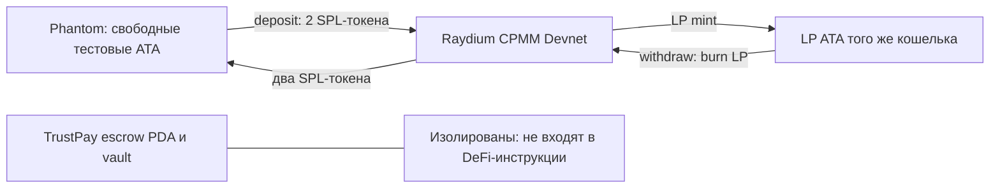

# Неделя 9 — DeFi на Solana: Raydium CPMM

Дата: 5 ноября 2026 (Asia/Almaty). Продолжение работающего escrow MVP недели 8. Недели 10–12 не выполнялись.

**Текущий статус:** интеграция завершена и проверена на настоящей Solana Devnet: создан учебный Raydium CPMM-пул, выполнены депозит и вывод, проверены фактические LP-балансы. Все три публичных Devnet-теста прошли. Escrow-контракт и его полномочия не изменены. Ранее публичная проверка ожидала пополнения: RPC faucet вернул `410 Gone`; после получения бесплатных Devnet SOL сценарий выполнен без использования Mainnet и реальных средств.

## 1. Исследование и выбор

| Протокол        | Подтверждение сети                                                                               | Возможный сценарий                                                                 | Решение                                                                                                     |
| --------------- | ------------------------------------------------------------------------------------------------ | ---------------------------------------------------------------------------------- | ----------------------------------------------------------------------------------------------------------- |
| Raydium CPMM    | Официальные исходники и SDK публикуют отдельный Devnet program ID; RPC вернул `executable: true` | Внести два свободных SPL-токена → получить LP; затем сжечь LP и вывести оба актива | Выбран для интеграции управления ликвидностью                                                               |
| Orca Whirlpools | Официальный README указывает Devnet; RPC также вернул `executable: true`                         | Concentrated liquidity с позициями и диапазонами                                   | Реальный кандидат, но диапазоны/tick arrays и позиции усложняют учебный сценарий; интеграция не реализована |

Первичные источники:

- [Raydium: Devnet program IDs в официальном SDK](https://github.com/raydium-io/raydium-sdk-V2/blob/master/src/common/programId.ts).
- [Официальная программа Raydium CPMM: Devnet ID и настройки](https://github.com/raydium-io/raydium-cp-swap/blob/master/programs/cp-swap/src/lib.rs).
- [Официальные SDK-инструкции создания пула, депозита и вывода](https://github.com/raydium-io/raydium-sdk-V2/blob/master/src/raydium/cpmm/instruction.ts).
- [SDK-layout состояния пула и конфигурации](https://github.com/raydium-io/raydium-sdk-V2/blob/master/src/raydium/cpmm/layout.ts).
- [Orca Whirlpools: официальный README и список сетей](https://github.com/orca-so/whirlpools#readme).

Выбор CPMM — инженерное решение для TrustPay: простой полный цикл LP на выделенных тестовых средствах, без изменения escrow-программы. Предоставление ликвидности не гарантирует доходности. Комиссионный доход зависит от реального торгового объёма; есть непостоянные потери и риск самого протокола. APR/TVL/USD-оценки в интерфейсе не выдумываются.

## 2. Проверенная Devnet-конфигурация

| Параметр                   | Реально проверенное значение                                         |
| -------------------------- | -------------------------------------------------------------------- |
| RPC                        | `https://api.devnet.solana.com`                                      |
| Genesis hash               | `EtWTRABZaYq6iMfeYKouRu166VU2xqa1wcaWoxPkrZBG`                       |
| Raydium CPMM program       | `DRaycpLY18LhpbydsBWbVJtxpNv9oXPgjRSfpF2bWpYb`                       |
| Program executable / owner | `true` / `BPFLoaderUpgradeab1e11111111111111111111111`               |
| Config index 0             | `5MxLgy9oPdTC3YgkiePHqr3EoCRD9uLVYRQS2ANAs7wy`                       |
| Config owner / bytes       | Raydium CPMM Devnet / 236                                            |
| `disableCreatePool`        | `false`                                                              |
| `createPoolFee`            | 150000000 lamports = **0,15 тестового SOL**                          |
| Pool creation fee account  | `3oE58BKVt8KuYkGxx8zBojugnymWmBiyafWgMrnb6eYy`                       |
| Fee account owner / bytes  | Classic Token Program / 165                                          |
| SDK                        | `@raydium-io/raydium-sdk-v2` **0.2.81-alpha**, закреплён lock-файлом |

Orca Devnet executable дополнительно проверен по адресу `whirLbMiicVdio4qvUfM5KAg6Ct8VwpYzGff3uctyCc`.

Для read-only браузерной проверки официальный Raydium Devnet API нашёл существующий пул `6RLToRXHVoFunGgc3B53BvYcKBsbf9BA7CuD9Xz1pU8N`. Далее интерфейс проверил его через RPC и показал настоящие vault reserves и mint-адреса. Это чужой существующий пул, **не созданный TrustPay**; наличие его токенов у пользователя не предполагается. API применяется только для обнаружения адреса в QA, не для цен, доходности и построения транзакций. Пользователю нужен собственный баланс обоих токенов либо отдельная учебная пара из setup.

## 3. Реализация

- `shared/defi.ts`: общий модуль сети, чтения пула, точных quote и построения транзакций через официальные Raydium SDK instruction builders.
- `app/src/DeFiPanel.tsx`: отдельная вкладка, загрузка пула, mint-адреса, резервы и ATA-балансы кошелька, выбор депозит/вывод, quote, согласие, реальная подпись и Explorer.
- `scripts/week09-setup.ts`: отдельный тестовый keypair, проверка Devnet и баланса, создание двух новых classic SPL mint и реального CPMM-пула.
- `scripts/lib/defi-fixture.ts`: создание учебной пары и пула; используется также тестом неизменённой программы на локальном validator.
- `tests/defi-math.ts`: арифметика и отрицательные проверки.
- `tests/defi-local.ts`: реальные транзакции оригинальной программы Raydium, клонированной из Devnet в локальный validator.
- `tests/defi-devnet.ts`: opt-in тесты публичных Devnet-транзакций.
- `tests/browser-defi.mjs`: read-only Chrome QA с настоящим Devnet RPC и существующим пулом.



### Проверки и лимиты

Программа жёстко выбрана по официальному Devnet ID; frontend RPC ограничен официальным Devnet или Helius Devnet. Проверяется настоящий genesis hash до доступа к программе и перед построением транзакции. Mainnet и локальный validator отклоняются в пользовательском DeFi-потоке.

Пул проверяется по владельцу, discriminator `PoolState`, размеру SDK-layout, token program, mint и vault authority. Поддерживаются только классические SPL-токены, без Token-2022 и автоконвертации SOL/wSOL. Резервы считаются из настоящих vault balances за вычетом накопленных protocol/fund/creator fees.

Quote использует BigInt и state LP supply, без Number для денежных величин. Для депозита требуемые суммы округляются вверх, задаются **максимумы** списания A/B. Для вывода количества округляются вниз, задаются ненулевые **минимумы** получения A/B. Slippage: 1–500 bps, по умолчанию 50 bps (0,5%). Quote старше 60 секунд отклоняется до запроса подписи. On-chain лимиты защищают также от изменения цены во время подтверждения кошелька. Проверяются свободные ATA-балансы. Создание ATA идемпотентно и входит в ту же транзакцию.

После подписи сохраняется настоящий signature, в том числе до ответа `sendRawTransaction`; при неопределённом результате следует проверить Explorer. После подтверждения перечитываются резервы и балансы. Таймаут не выдаётся за успешную операцию. Возвращённая сумма LP при выводе зависит от состояния пула и округления; доходность не гарантируется.

### Изоляция escrow

Контракт `programs/trustpay` **не изменён**. DeFi-builder принимает публичный адрес кошелька и вычисляет только его ATA; указать произвольный escrow source невозможно через API builder. Никаких одобрений, делегирования и PDA signer seeds TrustPay в Raydium-инструкции не добавляется. Подписант — кошелёк владельца свободных токенов. Перед операцией пользователь подтверждает использование только собственных свободных тестовых средств.

Локальный интеграционный тест отдельно блокирует 25 тестовых токенов в настоящем TrustPay escrow, проводит LP-операции и подтверждает неизменность **баланса vault и всех байтов состояния заказа**.

## 4. Запуск

Установлен стек недели 8: Node 22.18+, Solana CLI 2.1.0, Anchor 0.31.1. Дополнительно SDK Raydium и явно закреплённый ts-node:

```sh
npm ci
npm run test:defi
npm run build
npx tsc --noEmit -p tsconfig.json
```

### Публичная Devnet-проверка

```sh
npm run defi:setup
```

При первом запуске создаётся `.anchor/week09-wallet.json` с правами 0600; ключ не выводится и игнорируется Git. Если баланс недостаточен, скрипт печатает **публичный** адрес. Получите на него только бесплатные Devnet SOL через [официальный faucet](https://faucet.solana.com). RPC `requestAirdrop` в текущей Devnet вернул `410 Gone` и направил на этот сайт.

Повторите setup после пополнения. Минимальный стартовый баланс определяется прочитанной pool creation fee плюс 0,1 тестового SOL на rent/комиссии; на момент проверки — 0,25 SOL. Один Devnet SOL достаточен для планируемой проверки. Mainnet SOL не отправлять.

Setup создаёт два новых тестовых mint (6 decimals), выпускает по 10000 токенов, вносит по 1000 в настоящий Raydium-пул. Сохраняет публичные адреса и подпись в `.anchor/week09-fixture.json`; повторный успешный запуск переиспользует пул. Ключи mint не коммитятся. При сбое до сохранения fixture возможны частично выполненные подготовительные операции: проверьте кошелёк/Explorer перед повтором.

```sh
npm run test:defi:devnet
```

Тесты должны провести депозит и вывод на **настоящей** Devnet, проверить точные изменения LP и лимиты токенов; дополнительно проверяются устаревший quote и недостаточный баланс. Подписи и before/after balances сохраняются в `.anchor/week09-evidence.json` и печатаются после подтверждения. Никаких заранее записанных успешных подписей нет.

### Интерфейс и Phantom

Добавьте в `app/.env.local`:

```dotenv
# Отдельное DeFi-соединение, не меняет escrow Localnet.
VITE_DEFI_RPC_URL=https://api.devnet.solana.com
VITE_DEFI_POOL_ID=PUBLIC_POOL_ID_FROM_SETUP
```

```sh
npm run dev -w app
```

Откройте вкладку «DeFi · Raydium». Подключите отдельный тестовый Phantom-кошелёк, используйте Devnet. Не импортируйте CLI keypair в расширение. Для ручного сценария требуются Devnet SOL и токены обеих учебных mint в **собственных ATA Phantom**; CLI setup по умолчанию выдаёт их CLI-кошельку. Их можно передать из CLI-кошелька на публичный адрес Phantom через SPL Token CLI; либо провести CLI integration tests, не заявляя о ручной проверке расширения.

Порядок: загрузить реальный пул → внести сумму A → проверить рассчитанный B, LP и максимумы → подтвердить согласие и транзакцию → проверить LP баланс → рассчитать вывод LP → проверить минимумы → подтвердить вывод → проверить оба баланса и Explorer.

VITE-переменные публичны. Если используется Helius, ключ будет виден браузеру: используйте ограниченный Devnet-ключ и не добавляйте `.env.local` в Git.

### Тест неизменённой программы Raydium локально

Этот сценарий **не является подтверждением публичных Devnet-транзакций**. Он выполняет настоящие транзакции против bytecode официального Devnet deployment на собственном локальном ledger, а не против mock/самописного AMM. Нужен RPC-доступ для первоначального клонирования. Убедитесь, что порт 8899 свободен и TrustPay SBF уже собран.

```sh
solana-test-validator \
  --ledger .anchor/week09-ledger \
  --url https://api.devnet.solana.com \
  --clone-upgradeable-program DRaycpLY18LhpbydsBWbVJtxpNv9oXPgjRSfpF2bWpYb \
  --clone 5MxLgy9oPdTC3YgkiePHqr3EoCRD9uLVYRQS2ANAs7wy \
  --clone 3oE58BKVt8KuYkGxx8zBojugnymWmBiyafWgMrnb6eYy \
  --bpf-program ojfaRp5p9b8ZyK5VH5VQQQYxTWy8hi3QTorcTHtN19A target/deploy/trustpay.so
```

Если после собственной пересборки TrustPay program ID изменился, используйте текущий ID из `anchor keys list` вместо адреса выше.

В другом терминале:

```sh
npm run test:defi:local
```

Внутренний `localFixture=true` ограничен localhost и применяется только этими тестами. В DeFiPanel нет переключателя, позволяющего обходить проверку Devnet. Тест создаёт новые одноразовые ключи в памяти и не трогает Devnet-кошелёк.

### Chrome QA

При запущенном Vite и установленном Google Chrome:

```sh
npm run test:defi:browser
```

Read-only проверка: переключение вкладки, проверка изоляции escrow, отклонение ошибочного пула, загрузка существующего реального Devnet-пула, desktop 1440px/mobile 390px, отсутствие горизонтального переполнения и page errors. Скриншоты: `.anchor/browser/week09-desktop.png` и `week09-mobile.png`. Этот тест не подменяет подпись Phantom и не отправляет транзакций.

### Браузерный E2E с настоящими Devnet-транзакциями

```sh
npm run test:defi:browser:transactions
```

Opt-in проверка требует успешного setup, пополненного отдельного тестового кошелька и работающего Vite. Она подписывает настоящие небольшие депозит/вывод на Devnet через тестовый wallet provider, проверяет реальный LP-баланс и сохраняет подписи в `.anchor/week09-browser-evidence.json`. Приватный keypair остаётся в Node-процессе; браузер получает только подпись. Это проверка интерфейса и цепочки отправки, **не ручная проверка расширения Phantom**. Скрипт не запускается обычной командой `npm test`.

Фактически выполнено: после browser deposit LP изменились `1005499900 → 1006499900`, после browser withdrawal — `1006499900 → 1005999900` минимальных единиц. Проверено, что обновлённый LP-баланс в интерфейсе совпадает с RPC. Скриншоты сохранены в `.anchor/browser/week09-deposit-quote.png`, `week09-deposit-confirmed.png`, `week09-withdraw-confirmed.png`.

## 5. Фактические результаты

| Проверка                                 | Результат                                                                                                 |
| ---------------------------------------- | --------------------------------------------------------------------------------------------------------- |
| Devnet genesis + Raydium/Orca executable | Успешно, реальные RPC-запросы                                                                             |
| Raydium config и fee account             | Успешно, реальные RPC-запросы                                                                             |
| `npm run test:defi`                      | **6 passing**                                                                                             |
| `npm run test:defi:local`                | **4 passing (5s)**, настоящие LP mint/burn и slippage rejection оригинальной программы                    |
| Регрессия Anchor на работающем validator | **17 passing (12s), 7 pending**: 11 escrow + 6 unit; opt-in local/devnet suites по умолчанию отключены    |
| `npm run test:defi:browser`              | Успешно: реальный Devnet RPC, ошибочный/существующий пул, desktop/mobile, без page errors                 |
| `npm run build`                          | Успешно, DeFi SDK вынесен в lazy chunk; сохраняется предупреждение Vite о размере основного bundle        |
| `npx tsc --noEmit -p tsconfig.json`      | Успешно                                                                                                   |
| `npm run test:defi:devnet`               | **3 passing (6s)**: настоящие Devnet депозит/вывод, LP mint/burn, stale quote и insufficient balance      |
| `npm run test:defi:browser:transactions` | Успешно: реальные Devnet депозит/вывод через UI, проверены LP-балансы и подписи; тестовый wallet provider |
| Ручная подпись в Phantom                 | Не выполнялась                                                                                            |

Семь `pending` в общем запуске — четыре opt-in локальных теста (успешно выполнены отдельной командой) и три opt-in Devnet теста (успешно выполнены отдельной командой). Это не семь успешных тестов и не скрытые ошибки.

`npm install` / audit сообщает **28 advisory: 1 low, 20 moderate, 7 high**, в том числе у legacy Solana/Anchor-стека и добавленных зависимостей. `npm audit fix --force` не применялся. SDK alpha закреплён; интеграция не прошла независимый аудит и предназначена исключительно для учебных сетей. Возможный upgrade Devnet-программы может потребовать повторной проверки layouts/SDK; несовпадение layout сейчас приводит к отказу, а не к неподтверждённой операции.

## 6. Материалы для сдачи

Реальные публичные транзакции из `.anchor/week09-evidence.json` проверены. Эти ссылки ведут в Devnet, не в локальный ledger:

1. Создание учебного Raydium CPMM-пула (`createSignature` из fixture).
2. Подтверждённый Devnet депозит и LP до/после.
3. Подтверждённый Devnet вывод и оба токена до/после.

### Подтверждённые Devnet-транзакции

Учебный пул: [8biZWzVLXx9AC5N2c3mJjbeGLGMRJzuDksCSibnvHsB3](https://explorer.solana.com/address/8biZWzVLXx9AC5N2c3mJjbeGLGMRJzuDksCSibnvHsB3?cluster=devnet).

| Операция               | Реальная транзакция                                                                                                                                       |
| ---------------------- | --------------------------------------------------------------------------------------------------------------------------------------------------------- |
| Создание пула          | [Solana Explorer](https://explorer.solana.com/tx/2WdAMMgTrKV4PBBeZXZV9NRiwBcVTE9mEcYxdm9QG9dZUpvK7gA65u36cjEujeW5NJPbwMA517WoDwbTj24FoK2H?cluster=devnet) |
| Депозит и получение LP | [Solana Explorer](https://explorer.solana.com/tx/3dtTMz3k49g3junVZhdpQQsuTtHDvZ6spMYtJZCJ7xmQ2Xwi3faHhxRN3NwRqG6KgjdLwL1H1bBoBVmQDb5xTUMo?cluster=devnet) |
| Вывод и сжигание LP    | [Solana Explorer](https://explorer.solana.com/tx/2hvJzsnL31AHaTmEZYRSsiQFAq3ZUdJs7EDKm3QRWnkp51yLNQEPE1aoDopJsNngGVGD9pQtrok87NyuJVUzKY57?cluster=devnet) |
| Депозит через браузер  | [Solana Explorer](https://explorer.solana.com/tx/4e47xNXHoirhYy8Qmv1ArTHBmFP9Ed9qSqmLkYuS5qnYu9yPu5JmCb7FtQqdh8J25RPFSXSyFudW5zEGzjMi1rmP?cluster=devnet) |
| Вывод через браузер    | [Solana Explorer](https://explorer.solana.com/tx/49Y8qSP22PHQYhZYMUbi9kG6HNHsSSEng8BFZvrXqJE5th6RD3TnncXNggYmWzfuccMU8AFovtN4KKQCkgJZCGnY?cluster=devnet) |

Проверенные изменения в минимальных единицах (A / B / LP):

- `deposit`: `9000000000, 9000000000, 999999900` → `8990000000, 8990000000, 1009999900`.
- `withdraw`: `8990000000, 8990000000, 1009999900` → `8995000000, 8995000000, 1004999900`.

Подписи и балансы сохранены в игнорируемом `.anchor/week09-evidence.json`; публичные доказательства сдачи также собраны в `docs/week09-devnet-evidence.json` без ключей кошелька.

Скриншоты:

- `week09-01-defi-pool.png`: пул, сеть Devnet, mint-адреса и балансы.
- `week09-02-deposit-quote.png`: LP и максимумы A/B до подписи.
- `week09-03-deposit-confirmed.png`: настоящая подпись, Explorer и полученные LP.
- `week09-04-withdraw-confirmed.png`: burn LP и возвращённые токены.
- `week09-05-escrow-isolation.png`: escrow остался Funded с прежней суммой.
- `week09-06-tests.png`: результаты unit/local/Devnet suites с явным указанием сети.

Не помещайте keypair, seed-фразы, RPC API-ключи и `.anchor/` в Git. Ссылка на опубликованный коммит недели 9 сохранена в [WEEKLY_COMMITS.md](../WEEKLY_COMMITS.md). Недели 10–12 не выполняются автоматически.
