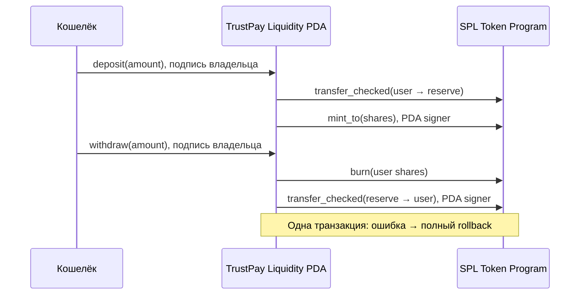

# Неделя 10 — CPI withdrawals и RPC Dashboard

Реализация и локальные проверки: 5 ноября 2026. Завершающая Devnet-проверка: 7 ноября 2026, Asia/Almaty. Выполняется только неделя 10. Недели 11–15 не реализуются.

## Цель и аудит исходного проекта

Объединить требования курса: безопасный вывод добровольных депозитов через CPI и Dashboard с настоящими blockchain-данными, сохранив escrow MVP и DeFi недели 9.

Проверены исходные коммиты:

- [Неделя 8](https://github.com/yerkesha-A/trustpay-solana/commit/1f375ddbbe81df8c355bd12ca3acaa72c8dd2c8f): escrow-заказы, изолированные PDA/vault, SPL transfer CPI, сдача/выплата/согласованный возврат.
- [Неделя 9](https://github.com/yerkesha-A/trustpay-solana/commit/3040230ef14641ca7bb85e6bf0a64294287712de): реальный Raydium CPMM Devnet, LP mint/burn, прямые добровольные операции кошелька. Пять сохранённых доказательств повторно проверены через Devnet RPC: все `finalized`, `err: null`.

**Обнаруженный пробел:** отдельного Liquidity Vault TrustPay и его share-токенов в неделе 9 не было. LP Raydium не выдаются за собственные shares TrustPay. Перед изменением архитектуры пользователь явно согласовал новый отдельный Vault: один SPL mint на Vault, SPL shares 1:1, transfer/mint CPI при депозите, burn/PDA transfer CPI при выводе. Escrow и Raydium сохраняются, доходность/AMM-маршрутизация не добавляются.

**Текущий статус:** Шесть Devnet contract/RPC-тестов и Chrome Devnet Dashboard E2E прошли. TrustPay развёрнут в Devnet 7 ноября. Executable, SHA-256 bytecode и исходный upgrade authority проверены. Локальные contract/RPC/UI-проверки прошли; результаты отдельного Devnet-прогона приведены ниже.

## Реализовано

- `programs/trustpay/src/liquidity.rs`: отдельные LiquidityVault, reserve и share mint; initialize, deposit и withdraw; события операций.
- `programs/trustpay/src/lib.rs`: добавлены три инструкции и новые сообщения ошибок; прежние escrow-инструкции, данные Order, статусы и seeds сохранены.
- `shared/liquidity.ts`: PDA, проверка настоящего состояния/балансов, построение CPI-транзакций, отправка через кошелёк и подтверждение конкретной подписи.
- `shared/rpc.ts`: Devnet/localnet guards, bounded retry/backoff, SOL/SPL balances, история и декодирование реальных Anchor-инструкций.
- `app/src/RpcSectionBoundary.tsx`: ошибки конфигурации/загрузки раздела показываются без падения всей страницы.
- `app/src/RpcDashboard.tsx`: новый раздел с кошельком, Vault, share balances, заказами, историей и активностью программы.
- `scripts/week10-deploy.mjs`: guarded Devnet-deploy с существующими signer/program keypair, rent-проверкой и сверкой bytecode SHA-256.
- `tests/liquidity.ts`, `tests/rpc.ts`, `tests/liquidity-devnet.ts`, `tests/browser-dashboard.mjs`: отдельные contract/unit/Devnet/UI-проверки.

## Liquidity Vault и shares

В существующую программу добавлены новые типы аккаунтов; миграция или удаление старых escrow-заказов не требуются.

| Аккаунт               | Seeds                          | Назначение                                               |
| --------------------- | ------------------------------ | -------------------------------------------------------- |
| LiquidityVault        | `liquidity`, underlying mint   | Неизменяемые mint, reserve, share mint, bump             |
| Reserve token account | `liquidity_reserve`, Vault PDA | Только добровольные токены этого Vault                   |
| Share mint            | `liquidity_shares`, Vault PDA  | Mint authority — Vault PDA, freeze authority отсутствует |
| Старый escrow Order   | `order`, client, id            | Прежнее состояние заказа                                 |
| Старый escrow vault   | `vault`, Order PDA             | Прежняя блокировка оплаты заказа                         |

Один минимальный underlying unit соответствует одному минимальному share unit; decimals одинаковые. Это **idle custody Vault без доходности**, не AMM и не NAV-vault с изменяемой ценой доли. Shares — обычные переводимые SPL-токены: после добровольной передачи право вывода принадлежит текущему владельцу shares. Dashboard показывает это право как «Доступно из Vault», а не выдуманную историю первоначальных взносов.

### CPI-депозит

1. Подписант — владелец source token account и share destination.
2. Проверяются mint, canonical PDA, token authority, достаточность токенов, покрытие supply резервом и checked u64 arithmetic.
3. `transfer_checked`: пользовательский token account → отдельный reserve.
4. `mint_to`: выпускается ровно amount shares в пользовательский account. Авторизация — PDA signer seeds Vault.
5. Публикуется событие `LiquidityDeposited`.

### CPI-вывод

1. Подписант владеет share source и underlying destination; чужие accounts не принимаются.
2. Проверяются reserve/share mint/PDA, amount > 0, достаточность shares и reserve, checked arithmetic.
3. `burn`: списывается ровно amount shares с подписью владельца.
4. `transfer_checked`: reserve → пользовательский token account, подпись только Vault PDA через `with_signer` и canonical seeds.
5. Публикуется событие `LiquidityWithdrawn`.

Оба CPI находятся в одной Solana-транзакции. Если перевод underlying не проходит, burn откатывается. Это проверено тестом замороженного destination. После полного сжигания shares повторный вывод отклоняется. Излишки, присланные прямо в reserve, не создают shares и не превращаются в дополнительное право вывода.



### Техническая изоляция escrow

У Liquidity Vault другой тип состояния, свои seeds и mint authority. Нельзя подставить escrow vault вместо reserve или пользовательского token account: сработают has_one/PDA/token-authority constraints. Из escrow нет CPI в Liquidity Vault или Raydium. Тест создаёт настоящую блокировку escrow, выполняет депозит/вывод в Liquidity Vault и сравнивает баланс escrow vault и все байты Order до/после. Они не меняются.

## Как Dashboard получает данные

Используются стандартные [Solana RPC методы](https://solana.com/docs/rpc/http), без API с фиктивными ценами или балансами:

| Данные                                     | Источник                                                                                                                     |
| ------------------------------------------ | ---------------------------------------------------------------------------------------------------------------------------- |
| SOL кошелька                               | `getBalance`, confirmed; проверка safe integer                                                                               |
| Classic SPL и Token-2022                   | `getParsedTokenAccountsByOwner`, сумма raw integer amounts по mint                                                           |
| Reserve, share supply, shares пользователя | `getAccountInfo` и `getMultipleAccountsInfoAndContext`, SPL account/mint decode                                              |
| Доступный добровольный депозит             | Текущие собственные shares 1:1, не escrow и не LP Raydium                                                                    |
| Заказы и статусы                           | Два memcmp-фильтра по client/freelancer через Anchor `account.order.all`                                                     |
| История кошелька/депозитов/выводов/escrow  | `getSignaturesForAddress` по связанным адресам + `getParsedTransaction`                                                      |
| Название операции и amount                 | Реальные instruction bytes декодируются BorshInstructionCoder; для escrow release/refund неизменяемая сумма берётся из Order |
| Активность всей программы                  | Последние signatures program ID                                                                                              |
| Наличие программы                          | `getAccountInfo`, проверка executable                                                                                        |

Суммы SPL хранятся как BigInt, не как `uiAmount` с потерей точности. Если RPC не вернул баланс, показано «—»/ошибка, не ноль. Нулевой баланс отображается только после успешного ответа RPC. При неизвестных instruction bytes или недоступных деталях операции не угадываются.

История намеренно ограничена **12 уникальными транзакциями по максимум 8 связанным адресам**: wallet, выбранный Vault/reserve/share ATA, часть собственных Order PDA и token accounts. Это не полный архив всей жизни кошелька. Отдельно показаны последние 12 signatures всей программы, включая других пользователей. Для более старых записей доступны правильные Explorer-ссылки; полноценный индексатор/архивная пагинация не заявляются.

### Ошибки, rate limits и обновление

- Devnet и localnet выбираются явно; URL allowlist и genesis hash запрещают Mainnet/другую сеть.
- Каждый RPC-запрос имеет ограниченный retry/backoff для 429/сетевых сбоев; постоянные ошибки не повторяются.
- Browser RPC имеет timeout 15 секунд; отложенные результаты предыдущего кошелька/сети игнорируются, очереди истории отменяются.
- Секции загружаются с разделением ошибок: отказ SOL не превращает SPL balance в ноль и не скрывает доступные данные.
- loading, empty и error states различаются; если программа отсутствует в Devnet, балансы/история кошелька доступны, Vault controls отключены.
- После подтверждения выполняется повторное чтение RPC. Время обновления и slot Vault отображаются.
- Подпись сохраняется до ответа отправки; неопределённый timeout не выдаётся за подтверждение. Перед повтором нужно проверить Explorer.
- API-key query parameters маскируются в сообщениях об ошибках.

Источники CPI: [Anchor SPL Token Basics](https://www.anchor-lang.com/docs/tokens/basics), [создание token accounts/PDA authority](https://www.anchor-lang.com/docs/tokens/basics/create-token-account), [SPL burn](https://solana.com/docs/tokens/basics/burn-tokens). Код остаётся на проверенной версии Anchor 0.31.1, без миграции на новые версии из примеров документации.

## Технологии и совместимость

Rust stable 1.99.1, SBF Rust 1.79/platform-tools v1.43, Solana CLI 2.1.0, Anchor CLI/crates/SDK 0.31.1, Node 22.18.0, npm 10.9.3, web3.js 1.98.4, SPL Token JS 0.4.14. Raydium SDK 0.2.81-alpha недели 9 сохранён. Cargo/npm lock-файлы не обновлялись произвольно.

Сохраняются известные предупреждения Anchor о deprecated realloc, старого Cargo о resolver config и SBF о syscalls.txt из официального CLI 2.1.0. Сборка и реальные локальные CPI-проверки прошли; сообщения не скрываются. Независимого security audit нет.

## Команды запуска и проверки

```sh
npm ci
anchor build
npm run sync:idl
npm run build
npx tsc --noEmit -p tsconfig.json
npm run test:rpc
anchor test --skip-build
```

Используйте существующие `.anchor/local-wallet.json`, `.anchor/week09-wallet.json`, `target/deploy/trustpay-keypair.json`. Не запускайте keygen и не перезаписывайте их. Тестовые actor keys локального validator живут только в памяти тестов; новые постоянные Devnet-кошельки в неделе 10 не создаются.

Для Chrome UI-теста оставьте local validator работающим:

```sh
solana-test-validator \
  --ledger .anchor/week10-ledger \
  --bpf-program ojfaRp5p9b8ZyK5VH5VQQQYxTWy8hi3QTorcTHtN19A target/deploy/trustpay.so
solana airdrop 10 --url localhost --keypair .anchor/local-wallet.json
anchor test --skip-build --skip-local-validator --skip-deploy
```

В отдельном терминале:

```sh
npm run dev -w app
npm run test:dashboard:local
```

Contract suite сохраняет только публичную `.anchor/week10-local-fixture.json` для UI-теста. Chrome QA использует **существующий** CLI keypair через тестовый wallet provider, настоящие подписи и реальные local-validator транзакции. Дополнительно инъецируется только HTTP 429, без подстановки балансов/успешных транзакций. Это не ручная проверка расширения Phantom.

### Devnet

При первоначальном аудите TrustPay ещё не был развёрнут в Devnet, на существующем проектном кошельке было 0,81404496 SOL. 7 ноября подтверждено пополнение на 2,5 тестового SOL: перед развёртыванием баланс составил 3,31404496 SOL. Сборка — 364248 bytes; RPC rent ProgramData + Program account составляет примерно 1,8520918 тестового SOL, не считая комиссий и token accounts. Пополнение получено через пользователя; кошелёк, program ID и существующие keypair сохраняются.

После подтверждённого пополнения:

```sh
# Если solana не в PATH, укажите путь к существующему бинарнику.
TRUSTPAY_SOLANA_BIN="$HOME/.local/share/solana/install/active_release/bin/solana" npm run deploy:week10:devnet
npm run test:vault:devnet
npm run test:dashboard:devnet
```

Deploy script проверяет сеть, существующие signer/program ID и rent, задаёт max-len равным собранному размеру, затем сверяет executable и SHA-256 публичного bytecode с локальным `.so`. CLI может использовать промежуточный deployment buffer; это не новый пользовательский кошелёк. Приватный CLI recovery output не выводится. Не публикуйте игнорируемые `.anchor/` и deployment logs.

Публичный Devnet RPC во время первоначальной CLI-загрузки вернул HTTP 429, а CLI достиг timeout. Для продолжения добавлен `npm run deploy:week10:resume`: он находит только существующий Buffer upgradeable loader с authority текущего проектного кошелька, проверяет его размер/тип, пишет лишь несовпадающие блоки небольшими пакетами и подтверждает настоящие подписи. Новые keypair/Buffer accounts не создаются. После полного byte-for-byte сравнения buffer выполняется стандартный DeployWithMaxDataLen с существующими program/signer ключами; проверяются executable, hash и upgrade authority. Формат инструкций соответствует [официальному SDK Agave 2.1.0](https://github.com/anza-xyz/agave/blob/v2.1.0/sdk/program/src/bpf_loader_upgradeable.rs). Это служебное восстановление развёртывания, не функция Vault/escrow и не сценарий следующих недель.

```sh
# Только после незавершённой загрузки в уже созданный собственный buffer:
npm run deploy:week10:resume
```

Devnet-тест использует **существующий mint недели 9** и существующие проектные ключи. Новый Vault создаётся из PDA, share mint также PDA. Проверяются положительные/отрицательные операции, настоящий escrow lifecycle с прежним существующим local keypair в роли тестового исполнителя, затем реальные RPC-балансы и история. Public fixture/evidence сохраняются в `.anchor/week10-*.json`; никаких заранее записанных успешных подписей нет.


### Публичное развёртывание и доказательства

- [TrustPay в Devnet](https://explorer.solana.com/address/ojfaRp5p9b8ZyK5VH5VQQQYxTWy8hi3QTorcTHtN19A?cluster=devnet).
- [Транзакция deploy](https://explorer.solana.com/tx/3nMVUZsDF3UiXjSwM4EYqvZuAEc2Uwrpon34WEAqoojUFmuEEjd2YUsQaePykuuc2rgvx4j8MYi1u3B6U5s4MwiJ?cluster=devnet).
- SHA-256 собранного и размещённого bytecode: `e15a9a17d5053c4444fa0ba12f0ea4d14538eb4eb2d2a77028018002035d168b` (364248 bytes).

Все 10 опубликованных подписей повторно проверены через Devnet RPC: `finalized`, `err: null`. [Публичные доказательства и точные изменения балансов](week10-devnet-evidence.json). Массивы CPI-балансов указаны в минимальных единицах: underlying пользователя, shares пользователя, reserve, supply. Начальные shares финального contract-прогона включают остатки предыдущих попыток, прерванных HTTP 429; полный вывод обнулил их. После браузерного теста в добровольном Vault оставлено 1,5 тестового токена, обеспечивающего 1,5 shares. Два тестовых escrow-заказа из прерванных RPC-прогонов остаются Funded по 5 тестовых токенов; Vault их не использовал. Финальный escrow-прогон полностью завершён выплатой исполнителю.

- [deposit](https://explorer.solana.com/tx/3Snv3g5rRe1TTGPEunMvS1zR5dBhyNsCfEiXpRApKKqvR9rHANbwCsFCa71PkdeeRY3TfDPjdJdWcnrK2VbaE5Rq?cluster=devnet).
- [withdraw](https://explorer.solana.com/tx/BZW56iBt9xw72Ss96EKbFrRtvftJuyLYaprEasatmtsGi9xSFgAX5CUwRz6Fi2BYn4Xs6MycWueEVL6YrbnXLkd?cluster=devnet).
- [withdraw-all](https://explorer.solana.com/tx/48H2P3bsrd1b1QQ7B5mv3Ct7jWg22eLcK9y1B1Nz5ci3BKrDasGczcz95WaFv7TekXrrxoxUoDFETKEd3WD7zDdb?cluster=devnet).
- [release-escrow](https://explorer.solana.com/tx/5zDG4QnQ7R5wkwC3eyvTTJPt5FJmt4FrvnNbjvqLpUZqNC6D16kkGJLM6zMtxZgVYZ1AixZzjvy5AqkcN9sM7yQ6?cluster=devnet).
- [dashboard-deposit](https://explorer.solana.com/tx/4Joc8ujioJNWhwE2oGFJLZiQA3b2yAhAQjeZBuGbf6c7vr1HmBfEczycsGXrPNsqsFGnqjpSStTqaz7oRX24BAyz?cluster=devnet).
- [dashboard-withdraw](https://explorer.solana.com/tx/5JvfArjWxKkjHL5J5FfGrhrW28FCCPBevGvCbLaHUhhACx4owTRpVq53E8sCitGaKX6t1heVdZC9zedsWphT1e9f?cluster=devnet).

### Frontend / Helius

```dotenv
# Только публичные адреса. Ключ не добавлять в Git.
VITE_DASHBOARD_RPC_URL=https://api.devnet.solana.com
VITE_LIQUIDITY_MINT=EXISTING_TEST_MINT_PUBLIC_ADDRESS
```

Для Helius используется `https://devnet.helius-rpc.com/?api-key=...` в **игнорируемом** `app/.env.local`. Ключ не предоставлен, поэтому Helius не тестировался. VITE-переменные видны браузеру: такой RPC-ключ не является серверным секретом и должен иметь ограничения у провайдера. Реального ключа в репозитории нет.

Dashboard имеет собственный переключатель Devnet/localnet. Существующие вкладки проектов и Raydium используют прежние настройки. В каждой секции показана сеть, Explorer URL использует `cluster=devnet` либо `cluster=custom` для local validator.

## Фактические результаты

| Проверка                               | Результат                                                                                                                         |
| -------------------------------------- | --------------------------------------------------------------------------------------------------------------------------------- |
| Anchor SBF + IDL                       | Успешно                                                                                                                           |
| Local contracts + unit                 | **36 passing (28s), 13 pending** в финальном локальном прогоне: 12 новых Vault, 7 новых RPC unit, 11 escrow, 6 прежних arithmetic |
| `test:rpc`                             | **7 passing**                                                                                                                     |
| Chrome Dashboard localnet              | Успешно: настоящий CPI deposit/withdraw, правильные shares в UI/RPC, история, empty state, mobile, 429 transport fault            |
| Escrow browser regression              | Успешно: реальные localnet create/fund/submit/release и согласованный refund                                                      |
| Raydium browser regression (read-only) | Успешно: прежний DeFi-раздел читает настоящий Devnet-пул; токены не расходуются                                                   |
| Frontend production build              | Успешно; остаётся Vite warning о размере bundle                                                                                   |
| TypeScript + cargo fmt check           | Успешно                                                                                                                           |
| Совместимость IDL                      | Program ID и все прежние escrow instructions/account/type layouts/error codes совпадают с опубликованной версией                  |
| Read-only Devnet RPC                   | До deploy: 0,81404496 SOL, 3 mint, 6 транзакций; после пополнения: 3,31404496 SOL                               |
| Devnet deploy / Vault CPI              | Успешно: bytecode hash/authority совпадают; **6 passing (48s)** — реальные Vault CPI, отрицательные проверки, escrow payout, RPC история                                                                       |
| Chrome Dashboard Devnet writes         | Успешно: реальные deposit 2,5 / withdraw 1, shares 0 → 2,5 → 1,5; history, mobile, empty/error, Disconnect                                                                                                   |
| Helius                                 | Не проверялся: API-ключ не предоставлен                                                                                           |
| Ручной Phantom                         | Не проверялся: автоматизация использует test wallet provider                                                                      |

Тринадцать pending в локальном прогоне — opt-in проверки, не объявляемые успешными: 3 Raydium Devnet, 4 Raydium local clone и 6 новых TrustPay Devnet. Старые публичные доказательства недели 9 повторно подтверждены как finalized. Отдельный браузерный escrow E2E повторно прошёл после исправления wallet context; он действительно провёл локальные депозит/выплату/согласованный возврат. Devnet CPI-тесты запускаются отдельно от локального набора. Первые прогоны прерывались HTTP 429; тестовый транспорт теперь последовательно отправляет настоящие RPC-запросы и повторяет HTTP 429 с задержкой. Балансы и транзакции не подменяются.

## Ограничения

- Idle Vault имеет фиксированное соотношение 1:1 и не инвестирует в Raydium. LP Raydium, Vault shares и escrow — три разных механизма.
- Произвольные прямые token donations и прямой burn shares не возвращаются через sweep; лишний reserve не даёт другим пользователям права его забрать. Rent withdrawal/close не добавлены.
- Underlying mint с freeze authority может заблокировать token transfers; это риск выбранного тестового токена. Share mint Vault freeze authority не имеет.
- Доступны classic SPL assets для Vault; Token-2022 отображается в Dashboard, но не принимается как underlying.
- Frontend-операции используют ATA кошелька; Dashboard суммирует также другие token accounts. Если токены лежат только в не-ATA account, сначала переведите их в свой ATA.
- История — ограниченный RPC window, а не полный индексатор. При pruned/unavailable transaction details показано ограничение.
- Сохраняются ограничения escrow недели 8: без арбитража и автоматического возврата. Новые Vault shares их не меняют.
- npm advisory legacy-стека из недели 9 не выдаются за исправленные; это учебный проект без независимого аудита.

## Скриншоты для отчёта

1. Dashboard в Devnet: адрес кошелька, настоящие SOL/SPL balances и выбранная сеть.
2. Liquidity Vault PDA/reserve/share mint и суммы до депозита.
3. Подтверждённый CPI deposit: уменьшение underlying, увеличение reserve/shares.
4. Подтверждённый CPI withdrawal: burn shares и возврат underlying, настоящая подпись в Explorer.
5. Отрицательная попытка over-withdraw или чужого token account.
6. История депозитов/выводов и escrow, статусы заказов и program activity.
7. Исходный escrow Funded с неизменной суммой после Vault-операций.
8. Терминал с результатами contract/RPC/Devnet tests и отдельное mobile/429 состояние.

Локальные QA-скриншоты сохраняются в `.anchor/browser/week10-localnet-*.png`, Devnet — `.anchor/browser/week10-devnet-*.png`. Не выдавайте localnet-скриншоты за Devnet. Keypair, seed-фразы и API-ключи в скриншоты/репозиторий не включать.

## GitHub

Запланирован отдельный коммит `week10: implement CPI withdrawals and RPC dashboard`. Перед push требуется отдельное подтверждение пользователя, как указано в задании. Ссылка формируется только после успешного push и записывается в [WEEKLY_COMMITS.md](../WEEKLY_COMMITS.md). Неделя 11 не начинается автоматически.

### Исправление подключения Wallet Adapter

Во время браузерной проверки обнаружено, что `wallet-adapter-base-ui` подтягивал вторую копию `wallet-adapter-react` 0.15.40, тогда как приложение использует закреплённую 0.15.39. В результате UI-кнопка могла показывать Select Wallet при уже доступном кошельке. В Vite добавлен resolve.dedupe для React/React DOM/Wallet Adapter React, без обновления версий. Повторный UI-тест проверил отображение публичного адреса, работоспособный Disconnect и исчезновение старых балансов. Это исправление прежней совместимости, а не новая функция будущих недель.
