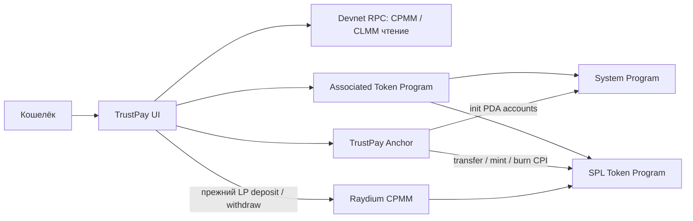

# Неделя 11 — AMM, CLMM и composable applications

Дата: 7 ноября 2026, Asia/Almaty. Только localnet и Devnet. Работа продолжает опубликованную [неделю 10](https://github.com/yerkesha-A/trustpay-solana/commit/361597c4a1064bec164da8e9440ae758042c6e38). Недели 12–15 не реализуются.

## Цель и исходный аудит

Объединить AMM/концентрированную ликвидность и взаимодействие нескольких Solana Programs в существующем TrustPay. Проверены README, Anchor.toml, Rust escrow/Vault, frontend, тесты, отчёты недель 8–10, main и origin `https://github.com/yerkesha-A/trustpay-solana.git`. До работы дерево Git чистое; неделя 10 присутствует в main, после неё опубликован отдельный коммит таблицы `c6d41b1`.

Ранее уже реализованы:

- Escrow: create/fund, submit, release, согласованный refund; выплаты через PDA signer seeds.
- Отдельный Liquidity Vault: добровольный депозит → transfer/mint CPI, вывод → burn/PDA transfer CPI, shares 1:1.
- Raydium CPMM Devnet: настоящие LP-депозит и вывод, прямые инструкции протокола из кошелька. Это не CPI из TrustPay в Raydium.
- RPC Dashboard: настоящие балансы, статусы, история, Explorer.

Пробелы: нет CLMM-чтения/диапазонов, отдельного AMM price-impact расчёта и тестов с проверкой inner instructions нескольких программ. Они закрыты этой неделей. Существующие on-chain инструкции и IDL не изменены; новый deploy TrustPay не требуется. Постоянные keypair и program ID сохранены.

## Реализовано

- Новая страница **DeFi / Liquidity** в боковой и мобильной навигации. Старые Projects, DeFi · Raydium и RPC Dashboard сохранены.
- Каталог двух публичных Devnet-пулов; пользователь может ввести другой адрес поддерживаемого CPMM/CLMM-пула. Каталог содержит адреса, а не заготовленные балансы. Загрузка всегда читает RPC.
- Пара mint A/B, реальные резервы, комиссия из on-chain AmmConfig, цена B/A, LP supply либо активная CLMM L/tick, slot и время чтения, ссылки Explorer с `cluster=devnet`.
- Phantom через прежний Wallet Adapter; SOL и SPL-балансы из RPC. До чтения показан empty/loading, при недоступности — ошибка или «—». Disconnect очищает состояние.
- AMM-котировка A→B/B→A: комиссия, ожидаемый и минимальный output, slippage, цена исполнения, curve price impact. Депозит/вывод настоящих CPMM LP доступны через существующий проверенный раздел, который перечитывает состояние после подтверждённой операции.
- CLMM-калькулятор: нижняя/верхняя цена, два бюджета, выравнивание по tick spacing, необходимые A/B, неиспользованный бюджет, L и потенциальная доля **активной** L при текущей цене. Изменение полей очищает предыдущий расчёт; данные старше 60 секунд требуют обновления.
- Чтение и расчёты CLMM явно отделены от создания позиции. Кнопка открытия заблокирована и объясняет ограничение. Ни успешная транзакция, ни позиция не имитируются.
- Тесты `tests/composability.ts` проверяют inner instructions, canonical PDA withdrawal и атомарный rollback композиции ATA + TrustPay.

## Сеть и реальные данные

Официальные адреса подтверждены по [Raydium program addresses](https://github.com/raydium-io/raydium-docs-v1/blob/main/reference/program-addresses.mdx) и установленному SDK. Дополнительно проверены Devnet genesis и executable программы через RPC:

| Протокол | Devnet Program |
| --- | --- |
| Raydium CPMM | `DRaycpLY18LhpbydsBWbVJtxpNv9oXPgjRSfpF2bWpYb` |
| Raydium CLMM | `DRayAUgENGQBKVaX8owNhgzkEDyoHTGVEGHVJT1E9pfH` |
| TrustPay | `ojfaRp5p9b8ZyK5VH5VQQQYxTWy8hi3QTorcTHtN19A` |

- [CPMM учебный пул недели 9](https://explorer.solana.com/address/8biZWzVLXx9AC5N2c3mJjbeGLGMRJzuDksCSibnvHsB3?cluster=devnet).
- [CLMM публичный Devnet-пул](https://explorer.solana.com/address/14gmqbdnjAFyRi1Vg3B7Fe6JGMut4CjbABXY1HqfvJnk?cluster=devnet).

При первоначальном RPC-поиске найдено 3906 аккаунтов размера CLMM PoolState. Это число найденных аккаунтов, **не** утверждение об активности всех пулов. Для каталога проверен один активный classic SPL пул. Проверяются owner/executable/discriminator/layout, config, mint decimals, token mint/authority, canonical vault PDA. Token-2022 CLMM отвергается: его transfer-fee расширения не учитываются текущим калькулятором.

[Публичное Devnet-доказательство](week11-devnet-evidence.json) и [результаты Chrome QA](week11-browser-evidence.json) содержит реальные raw reserves, sqrtPriceX64, активную L, ticks, fee, slot, расчёты и баланс тестового кошелька. Это timestamped snapshot, не постоянная текущая цена и не серверный кэш приложения. В read-only проверках транзакции не отправляются.

У существующего проектного кошелька баланс **обоих** mint выбранной CLMM-пары равен 0 в момент проверки. Native Devnet SOL не равен балансу wSOL token account. Токен B принадлежит стороннему тестовому mint; полномочий на выпуск у проекта нет. Поэтому проверка настоящего открытия/закрытия CLMM-позиции не выполнена. Не утверждается, что Raydium CLMM не поддерживает Devnet: программа и пул доступны. Реализован разрешённый заданием вариант чтения и расчётов с явным ограничением. Создание новой собственной пары/пула, wrap SOL, выпуск position NFT и перевод средств из escrow/Vault для обхода ограничения не выполнялись.

## AMM: формулы и единицы

Для CPMM (classic SPL без ненулевой дополнительной creator fee):

- `fee = ceil(input × tradeFeeRate / 1_000_000)`, комиссия читается из config.
- `net = input − fee`.
- `output = floor(net × reserveOut / (reserveIn + net))`.
- `minOutput = floor(output × (10_000 − slippageBps) / 10_000)`.
- Spot = `reserveB/reserveA × 10^(decimalsA−decimalsB)`, B за A; обратное направление меняет единицы.
- Execution price использует полный input; price impact сравнивает `output/net` с spot в raw единицах, исключая комиссию, но включая округление.

Все token amounts — BigInt/BN, без Number. Decimal 70-digit используется для отношений/цен; отображение округляется отдельно. Unit-тест сравнивает расчёт с закреплённым Raydium CurveCalculator в обоих направлениях. Slippage допускается 1–500 bps. Dust, u64 overflow, пустой/paused pool и неизвестная creator fee обрабатываются ошибкой. Котировка — расчёт по RPC-данным, не гарантия исполнения и не проведённый swap; новый swap-путь не добавлен.

## CLMM: диапазон и распределение

CLMM концентрирует L между ticks, а не по всему ценовому пространству. Цена B/A вычисляется из настоящего `sqrtPriceX64` с поправкой на decimals. Используются [TickUtil и LiquidityMathUtil закреплённого SDK](https://github.com/raydium-io/raydium-sdk-V2/tree/master/src/raydium/clmm/libraries), как в [официальном примере](https://github.com/raydium-io/raydium-sdk-V2-demo/blob/master/src/clmm/createPosition.ts).

Границы проверяются на положительность, конечность, порядок, диапазон протокола `[-443636,443636]`; нижняя округляется вниз, верхняя вверх по tick spacing. UI показывает **эффективные** цены после округления. Для sqrt-цен `a < b` и текущей `s`:

- При `s ≤ a`: нужен только токен A, `amountA = L × (b−a)/(a×b)`.
- При `a < s < b`: `amountA = L × (b−s)/(s×b)`, `amountB = L × (s−a)`.
- При `s ≥ b`: нужен только B, `amountB = L × (b−a)`.

SDK использует Q64, floor при выборе L из двух бюджетов и ceil для необходимых token amounts. Показаны остатки бюджета; превышение бюджета из-за округления отклоняется. Активность соответствует `[lower,upper)`. Для оценки доли используется `Lnew/(Lactive+Lnew)` только при текущей цене внутри диапазона; вне его показан 0. Это **не** доля всех позиций, TVL, исторических fees или прогноз APY.

При выходе цены за диапазон позиция становится односторонней и перестаёт получать торговые комиссии до возвращения цены. Узкий диапазон увеличивает риск выхода; возможны непостоянные потери. Текущий калькулятор не учитывает будущие swaps, изменяющиеся L, fees/rewards, transaction fees, rent и будущие изменения цены.

## CPI и архитектура



TrustPay init constraints вызывают System CPI для создания PDA и Token CPI для инициализации mint/reserve. ATA instruction вызывается приложением как top-level instruction; **сама Associated Token Program** вызывает System/Token через CPI. Она не выдаётся за CPI из TrustPay. Затем в той же атомарной транзакции вызывается deposit TrustPay → transfer_checked/mint_to CPI.

Withdraw: owner подписывает burn своих shares; transfer из reserve авторизован только canonical Liquidity Vault PDA seeds. Проверяются signer, account owner, token authority, mint, seeds/has_one, достаточность средств, checked arithmetic. Новые тесты подтверждают программы через настоящие `meta.innerInstructions` и runtime logs. При подмене share owner подтверждённая транзакция содержит `ConstraintTokenOwner`; предшествовавшее создание ATA и все token changes откатываются. Отдельные старые тесты проверяют rollback burn при failed CPI, двойной вывод и сохранность escrow.

Escrow reserve, Liquidity Vault reserve, Raydium LP и CLMM position — разные сущности. Новых полномочий переводить чужие средства или инвестировать locked escrow нет. Не добавлены искусственные CPI-инструкции или новый программный proxy к Raydium.

## Версии и команды

Сохранены Anchor 0.31.1, Solana CLI 2.1.0, web3.js 1.98.4, SPL JS 0.4.14, Raydium SDK 0.2.81-alpha, Node 22.18.0/npm 10.9.3. Rust stable 1.99.1; SBF использует platform-tools 1.43/Rust 1.79. Decimal.js 10.6.0 уже был транзитивной зависимостью SDK; он добавлен как прямая закреплённая зависимость, без обновления остального lockfile.

```sh
npm ci
anchor build
npm run sync:idl
npm run build
npx tsc --noEmit -p tsconfig.json
npm run test:market
npm run test:market:devnet
```

Для регрессии:

```sh
# Использовать свободный порт, новый ledger и существующий program keypair.
solana-test-validator --ledger .anchor/week11-ledger \
  --bpf-program ojfaRp5p9b8ZyK5VH5VQQQYxTWy8hi3QTorcTHtN19A target/deploy/trustpay.so
solana airdrop 10 --url localhost --keypair .anchor/local-wallet.json
anchor test --skip-build --skip-local-validator --skip-deploy
```

Для UI:

```sh
npm run dev -w app
npm run test:market:browser
npm run test:browser
npm run test:dashboard:local
```

`VITE_DEFI_RPC_URL` по умолчанию — официальный Devnet. Поддерживается Helius Devnet из игнорируемого `app/.env.local`; ключ не предоставлен и Helius не проверялся. Отдельная DeFi-сеть не меняет сеть escrow. Секреты не включаются в Git; браузерный VITE-ключ публичен и требует ограничений у провайдера.

## Результаты тестирования

Результаты заполняются по завершённым прогонам; пропущенные opt-in проверки не считаются успешными.

| Проверка | Результат |
| --- | --- |
| Anchor SBF/IDL build | Успешно |
| Frontend production build | Успешно; прежнее предупреждение Vite о большом bundle |
| TypeScript | Успешно |
| Локальный полный набор | **49 passing (31s), 16 pending**: прежние 36 + 9 market math + 4 multi-program CPI |
| AMM/CLMM math | **9 passing**: независимые Q64-уравнения, SDK parity, decimals, границы, односторонность, некорректные данные |
| Devnet market RPC | **3 passing (7s)**: CPMM/config/quotes, CLMM/диапазон/реальные балансы, wrong-protocol rejection |
| Chrome AMM/CLMM | Успешно: настоящие RPC-резервы/quotes, CLMM ticks/budgets, invalid range, wrong protocol, 429, wallet/disconnect, mobile |
| Escrow browser regression | Успешно: localnet create/fund → submit → release, agreed cancel → refund, ATA и точные балансы |
| Raydium browser regression | Успешно: прежний раздел, реальный Devnet-пул, bad pool, desktop/mobile |
| Vault browser regression | Успешно: настоящие localnet deposit 2,5 / withdraw 1, shares 0 → 2,5 → 1,5, history, error/mobile/disconnect |
| Реальное CLMM open/close | Не выполнялось; интерфейс явно read-only |
| Ручной Phantom / Helius | Не проверялись |

16 pending: прежние 3 Raydium Devnet, 4 Raydium local-clone, 6 Vault Devnet и 3 новых market Devnet opt-in. Три новых market-теста отдельно выполнены успешно; остальные opt-in проверки здесь не выдаются за повторно пройденные. Регрессия contract suite включает прежние 11 escrow, 12 Vault, 7 RPC unit и 6 arithmetic.

Первый CPI-прогон выявил задержку индексации `getTransaction` после подтверждения. Тест теперь ограниченно ждёт настоящую metadata, а не считает null доказательством ошибки программы. Повторный полный набор прошёл. Первую браузерную проверку прервала Vite-перезагрузка при редактировании файлов; она не объявляется успешной.

## Ограничения и материалы отчёта

- CLMM — настоящие RPC-данные и расчёт, без открытия/закрытия позиции. Статус программы не скрывается, успех подписания не имитируется.
- Котировки не исполняются; не добавлены swap, CLMM strategy, auto-rebalancing или доходность Vault.
- Каталог небольшой; это не полный on-chain индексатор. Последовательные чтения могут относиться к разным slots. CLMM использует minContextSlot для зависимых аккаунтов; это не атомарный snapshot всех данных.
- Classic SPL only для market math; transfer-fee/другие Token-2022 расширения не моделируются.
- CLMM reserve display включает vault fees; active L показывается отдельно. USD/TVL/APY не выдумываются.
- Публичный RPC может возвращать 429; показана понятная ошибка и доступно повторное обновление. В тестах реальный транспорт ограничивает частоту запросов; специально введённая HTTP 429 — отдельный отрицательный сценарий, не источник балансов.
- Прежние 28 npm advisory (1 low, 20 moderate, 7 high) legacy-стека сохраняются; независимого security audit нет.

Сохранить скриншоты в `.anchor/browser/`:

1. `week11-amm.png`: Devnet CPMM, mint-адреса, резервы, комиссия, quote/impact/slippage.
2. `week11-clmm.png`: реальный CLMM, цена, ticks, бюджеты, распределение, доля активной L и disabled open-position.
3. `week11-mobile.png`: экран 390 px.
4. Ошибка некорректного диапазона, wrong-protocol и HTTP 429.
5. Терминал с 49 passing и отдельным live Devnet-прогоном.
6. Inner instructions/logs init, ATA+deposit и withdraw из [публичного localnet-доказательства](week11-cpi-evidence.json) (localnet, не Devnet Explorer).

Не включать keypair, recovery phrases, API-ключи или `.anchor/` в репозиторий. Коммит недели 11: `week11: implement AMM CLMM and CPI integrations`; реальная GitHub-ссылка после успешного push добавляется в [WEEKLY_COMMITS.md](../WEEKLY_COMMITS.md).
