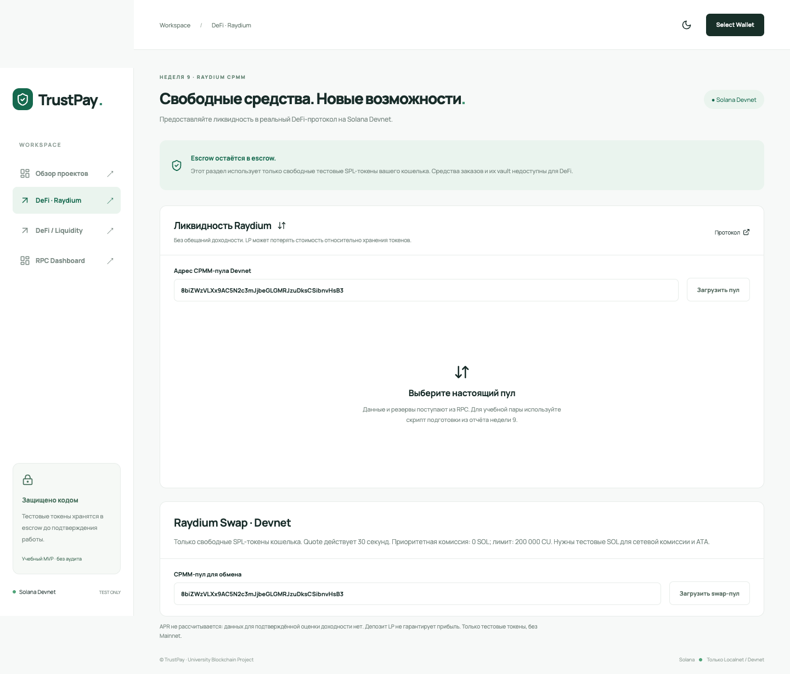
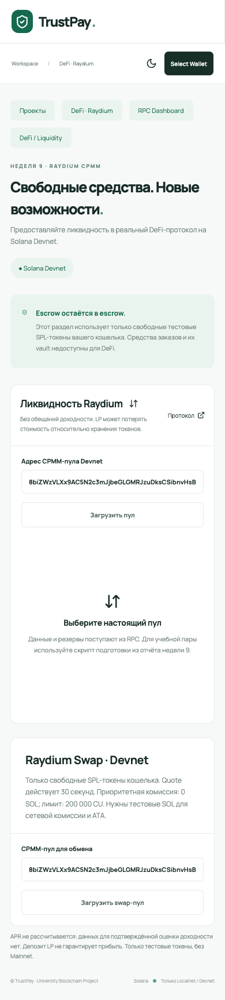

# Неделя 12 — Raydium Swap и Security Lab

Дата итоговой проверки: 7 ноября 2026 года (Asia/Almaty).

**Неделя 12 завершена в согласованном объёме: реальный Raydium Swap, ручная проверка Phantom на Devnet и безопасная Security Lab на изолированном localnet.** Успешный ручной swap независимо проверен по данным сети, а не заменён автоматическим тестом. История main сохраняется; завершающие изменения объединяются обычным merge по разрешению владельца.

## Цель и реализованные функции

Обмен свободных тестовых SPL-токенов через настоящий Raydium CPMM и проверка авторизации учебного vault. Существующий проект продолжен без изменения контрактов TrustPay и бизнес-логики предыдущих недель. Mainnet и escrow для swap не используются.

Во вкладке **DeFi · Raydium → Raydium Swap · Devnet** реализованы:

- Чтение настоящего CPMM-пула через Devnet RPC: владельцы, discriminator, mint/vault, резервы и on-chain комиссия. Есть готовый учебный пул и ввод другого публичного адреса.
- Выбор A → B / B → A, точные BigInt-расчёты output, комиссии, price impact и minimum received; slippage 1–500 bps.
- Quote на 30 секунд, привязанный к кошельку. Изменение полей сбрасывает quote; до подписи перечитываются пул и свободные балансы, проверяются PDA, доступность swap и цена относительно одобренного minimum.
- Источник и получатель — только ATA подписанта; создание output ATA идемпотентно. Заблокированные средства escrow и Liquidity Vault недоступны через этот путь.
- Запрос подписи Phantom, проверка возвращённого message и подписи, preflight, отправка, подтверждение без ошибки, обновление балансов и ссылка Explorer.
- Обработка отказа кошелька, недостаточного баланса, RPC-ошибок, истечения quote и неполученного подтверждения. Отсутствие подтверждения не объявляется успехом.
- Адаптивная форма, проверенная на desktop и 390 px без горизонтального переполнения.

Используется закреплённый `@raydium-io/raydium-sdk-v2@0.2.81-alpha`: layouts/PDA и `makeSwapCpmmBaseInInstruction`. Расчёты AMM сверены существующими тестами с SDK. Это настоящая инструкция Raydium, а не имитатор обмена.

## Подтверждённый ручной Phantom Swap

Владелец вручную подключил настоящий Phantom в Chrome, выбрал Solana Devnet и проверил отказ: «Отмена» вызвала `WalletSignTransactionError: User rejected the request`. После исправления подготовки Compute Budget владелец вручную подтвердил новую котировку **A → B, 1 токен, 50 bps**.

[Ручной swap в Solana Explorer](https://explorer.solana.com/tx/5VuPDpWkRiYfLcq5A22WfrAvFBLD2xjH5Yjjrb35KQZRmTzjpymNE8akhnAwCdDBT5b231otvq5rBvsdfA8Gb4Cw?cluster=devnet).

| Проверка по сети | Результат |
| --- | --- |
| Статус | **finalized**, без ошибки |
| Подписант / payer | `2mxYEEpyuuo1msxRXGB4wWNqeCeaPSrcywcw2Qq7tEab` |
| Криптографическая проверка подписи | Успешна |
| Input A | **1** (1000000 raw) |
| Output B | **0,996513** (996513 raw) |
| Minimum B в инструкции | **0,991530** (991530 raw) |
| Compute budget | 200000 CU, цена 0 micro-lamports/CU |
| Priority fee | **0 SOL** |
| Фактическая сетевая комиссия `meta.fee` | **0,000005 SOL** |
| Создание output ATA, rent-exempt balance | **0,00148844 SOL** |
| Общее уменьшение SOL подписанта | **0,00149344 SOL** |
| Программа TrustPay / escrow в аккаунтах транзакции | Отсутствует |

[JSON-доказательства](week12-phantom-success.json) содержат подпись, slot, результаты проверки signature, ATA, input/output/minimum и комиссий. `node scripts/week12-verify-phantom.mjs ПОДПИСЬ` воспроизводит проверку **только чтением**, без новых swap.

Оба mint — классические SPL-токены с 6 decimals, выпущенные учебным кошельком проекта; freeze authority отсутствует:

| Токен | Mint |
| --- | --- |
| A | `2CLKeMqA9MJxitEwYZi1bXmQx14QXS3gCm5xSHSs5SDf` |
| B | `2pybmyQorJG1CvyZ8eZMKgUca9BGAkze1MzQx6fR81wW` |

Неизвестное отображаемое имя в Phantom не является идентификатором mint: проверяются адреса. Перед тестом кошелёк получил 0,02 Devnet SOL и 5 A из свободных средств проекта. [Подготовительный перевод](https://explorer.solana.com/tx/1igjW8nNfq59PMntke5tgJbNgHCTbt8Y7j93uUJpMcojVnBNFEtwpjkgQxchVud5YR43RJs21srJR5xCNxWUYsk?cluster=devnet) не считается Phantom swap.

### Ранее подтверждённые программным учебным кошельком обмены

Сохранены исходные [доказательства двух CLI swap](week12-swap-evidence.json) и [повторная проверка finalized](week12-swap-reverification.json). Во время завершения ручной проверки эти обмены не повторялись.

- [A → B: input 1, output 0,996511](https://explorer.solana.com/tx/34yYvSnGXxJTUnxVCyuW7bzovDBp14P8wcug9oAAeciGHGTNnDKY8Zx1amYMYkoQGRtjgk8DsWJJSZBNK7tcgN7E?cluster=devnet).
- [B → A: input 1, output 0,998490](https://explorer.solana.com/tx/4EBbXzBYYTysG6v26iPRQcvhr5KATgCrCVUS6UvQBAgCK6H7j4ixn5xaEYRn3MDmMaemxedu68YUwgdMrLd5uHP?cluster=devnet).

## Phantom: причина несовместимости и исправление

Изначально приложение требовало побайтового равенства `serializeMessage()` до и после подписи. Добавлена проверка исполняемого содержания, допускающая только эквивалентную перестановку таблицы аккаунтов: payer, blockhash, полный набор signer/writable-прав, порядок инструкций, program IDs, порядок аргументов-аккаунтов и все instruction data остаются защищены. Снимок делается до await, поэтому изменение переданного объекта на месте не обходит проверку. Подпись проверяется на фактически возвращённом message.

Реальные данные из Chrome затем показали, что дело было **не только в представлении**: Phantom добавлял две Compute Budget инструкции перед исходными ATA и Raydium. [Точный публичный fixture](../tests/fixtures/week12-phantom-added-compute.json):

| Base58 data | Декодирование |
| --- | --- |
| `3qi1MbrtkR83` | SetComputeUnitPrice: 375000 micro-lamports/CU |
| `Fj2Eoy` | SetComputeUnitLimit: 200000 CU |

Приоритетная комиссия составляла ceil(200000 × 375000 / 1000000) = 75000 lamports; с базовыми 5000 это объясняет прежнюю оценку Phantom **0,00008 SOL**. [Документация Phantom](https://github.com/phantom/docs/blob/master/development-powertools/solana-priority-fees.md) описывает добавление priority fee при подписи, если приложение не задало Compute Budget. Защита правильно блокировала непредусмотренное изменение, до отправки транзакции.

Исправление в `shared/swap-budget.ts`: до запроса подписи приложение задаёт **200000 CU и цену 0**, затем ATA и swap — всего 4 инструкции. Интерфейс показывает эту политику. Изменение limit/price, добавление дубликатов или любых новых инструкций после подписи по-прежнему запрещены. Ручная финализированная транзакция подтверждает, что Phantom сохранил подготовленные параметры.

[Симуляция исправленного варианта](week12-phantom-compute-preflight.json): err=null, 38148 CU, priority fee 0. [Предыдущая симуляция](week12-phantom-preflight.json) и [проверка истории попыток](week12-phantom-attempt-check.json) сохранены для отчёта. Диагностика message до/после доступна только локально в `sessionStorage['trustpay:swap-signing-diagnostic']`; ключей и seed там нет. Offline-декодер: `node scripts/week12-decode-compute.mjs файл.json`.

## Security Lab и статическая проверка

**Security Lab завершена в безопасном объёме задания:** исправленный учебный контракт и регрессии отказа, исключительно на изолированном localnet. Демонстрации успешной эксплуатации не проводились; публичного деплоя лаборатории не было.

Исходный черновик содержал feature `vulnerable`, выбирающий Withdraw без `has_one=owner`. Правильный PDA и наличие произвольного Signer не связывают его с сохранённым владельцем. Default-контекст уже был исправлен; завершающее изменение удалило небезопасный feature/контекст **из всех сборок**. Исходные файлы сохранены локально в игнорируемой `.anchor/week12-original-lab/`; не публикуются и не запускаются.

В лаборатории проверены Signer → vault.owner, `has_one=mint`, PDA seeds/bump vault/reserve, владельцы типизированных аккаунтов Anchor, mint/authority token accounts, SPL Token program, положительная сумма и достаточный reserve. Модель ограничена одним vault на владельца и одним mint, без сторонних получателей и повторного deposit в уже созданный vault. Это учебный контракт, а не production vault.

Сборка только исправленного SBF выполняется offline/locked. Harness создаёт собственный loopback validator, новый ledger и project-owned test accounts; RPC identity сверяется с identity ledger, публичные genesis отклоняются. Отрицательные операции отклоняются preflight, балансы проверяются на неизменность. Ledgers, кошельки и бинарники не коммитятся.

[Security Lab evidence](week12-security-evidence.json): **12 отказов** (чужой Signer, отсутствие подписи, чужой получатель, неправильный mint назначения, подмена mint/vault/reserve, владелец account, Token program, zero/over-reserve/repeat withdrawal) плюс **1 подтверждённый разрешённый полный вывод** после депозита. Записан hash реально протестированного SBF.

Также повторно проверены исходники TrustPay и существующие контрактные регрессии:

- Escrow: Signer, has_one, order/vault PDA, mint и получатель по роли; смена статусов исключает повторный вывод, refund требует согласия freelancer.
- Liquidity Vault: отдельные PDA, связи mint/share/reserve, принадлежащие подписанту token/share accounts, burn собственных shares, backing/overflow checks и атомарность CPI. Escrow не подходит как пользовательский source.
- Swap: Devnet genesis, закреплённый CPMM program ID, повторная проверка pool/vault/observation PDA, свободные ATA и on-chain minimum.

Это ограниченный аудит исходников и регрессии, а не независимый полный security audit.

## Финальные проверки

| Проверка | Результат |
| --- | --- |
| `npm run test:unit` | **44 passing**, включая точные bytes Phantom и запрет изменения budget/получателей/сумм/прав |
| `npx tsc --noEmit -p tsconfig.json` | Успешно |
| `npm run build` | Успешно; прежнее предупреждение Vite о крупных chunks |
| `npm run build:security` | Исправленный SBF собран offline/locked |
| `npm run test:security` | 12 отказов + разрешённый вывод, exit 0 |
| `tests/trustpay.ts` + `tests/liquidity.ts` на отдельном localnet | **23 passing** |
| `npm run test:phantom:request` | Успешно; синтетический provider, отдельно от настоящего ручного теста |
| `npm run test:swap:browser` | Desktop/mobile 390 px, без page errors и переполнения |
| `node scripts/week12-verify-phantom.mjs` | Ручной swap finalized, проверены подпись, параметры и balances |

TrustPay регрессии используют существующий `target/deploy/trustpay.so`; Rust-код TrustPay не изменялся и не пересобирался. Лаборатория собиралась отдельно из исправленных исходников.

## RPC, запуск и воспроизведение

Для ручного теста в игнорируемом `app/.env.local` заданы:

```dotenv
VITE_NETWORK=devnet
VITE_RPC_URL=https://api.devnet.solana.com
VITE_DEFI_RPC_URL=https://api.devnet.solana.com
VITE_PROGRAM_ID=ojfaRp5p9b8ZyK5VH5VQQQYxTWy8hi3QTorcTHtN19A
```

Ранее раздел проектов обращался к отсутствующему localnet `127.0.0.1:8899`: смена сети Phantom сама по себе не меняет RPC приложения. Исправлена только локальная конфигурация текущего Devnet-запуска; прежний env сохранён в `.anchor/week12-phantom-localnet.env.backup`. Из Chrome без подмены RPC проверены HTTP 200, Devnet genesis, executable программы и `order.all()` (3 аккаунта). Секреты/env не публикуются.

```sh
npm ci
npm run dev -w app
npm run test:unit
npx tsc --noEmit -p tsconfig.json
npm run build
npm run build:security
npm run test:security
npm run test:phantom:request
# С запущенным frontend и установленным Chrome:
npm run test:swap:browser
# Только чтение подтверждённого ручного swap:
node scripts/week12-verify-phantom.mjs 5VuPDpWkRiYfLcq5A22WfrAvFBLD2xjH5Yjjrb35KQZRmTzjpymNE8akhnAwCdDBT5b231otvq5rBvsdfA8Gb4Cw
```

Для воспроизведения ручного теста открыть `http://127.0.0.1:5173` в Chrome с Phantom, выбрать Solana Devnet и отдельный учебный кошелёк с тестовыми SOL/токенами пары. Не импортировать CLI-ключ. Загрузить предзаполненный пул, выбрать A → B, amount 1, slippage 50 bps; получить свежую quote и подтвердить запрос. Не менять заданную комиссию в Phantom: изменённый message будет отклонён. После подтверждения проверить Explorer и обновлённые балансы. Новая попытка расходует тестовые токены и не требуется для подтверждения уже записанного результата.

## Скриншоты и ограничения





Скриншоты — настоящая форма приложения; успех ручного swap подтверждается Explorer и JSON, без поддельных изображений окна Phantom.

Поддерживаются CPMM и классические SPL-токены. Token-2022, SOL wrapping, CLMM swap, маршрутизация и каталог всех пулов не реализованы и не входят в этот учебный swap. RPC может ограничивать запросы; нужен запас Devnet SOL на fee/ATA. Quote действует 30 секунд; чтения RPC не являются единым snapshot, поэтому окончательную защиту цены обеспечивает minimum в инструкции. Нулевая priority fee не гарантирует скорость включения. При неопределённом результате отправки проверять подпись до повтора.

## GitHub

Опубликованный Raydium-коммит [`5fe787025d701a90c68275efdc275601b5295170`](https://github.com/yerkesha-A/trustpay-solana/commit/5fe787025d701a90c68275efdc275601b5295170) сохранён. Security Lab начата отдельным коммитом [`1bbb8a6be8cd031d2eebc09c17a219918c44634d`](https://github.com/yerkesha-A/trustpay-solana/commit/1bbb8a6be8cd031d2eebc09c17a219918c44634d). Исправления настоящей ручной интеграции и итоговый отчёт добавлены в той же ветке `week12-complete-security-lab`. Владелец разрешил обычный merge в main после успешных финальных проверок; force push и переписывание опубликованных коммитов не используются. Итоговый merge-коммит содержит полный результат недели 12; неделя 13 не начиналась.
