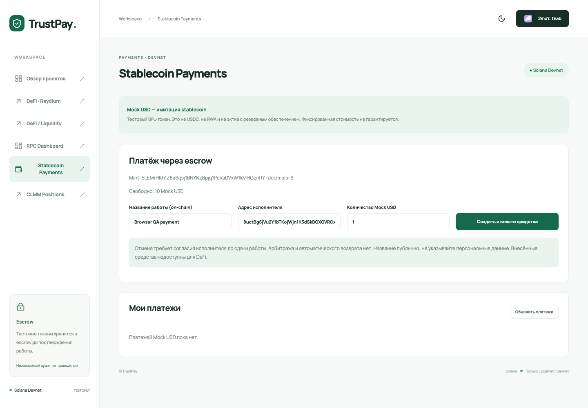
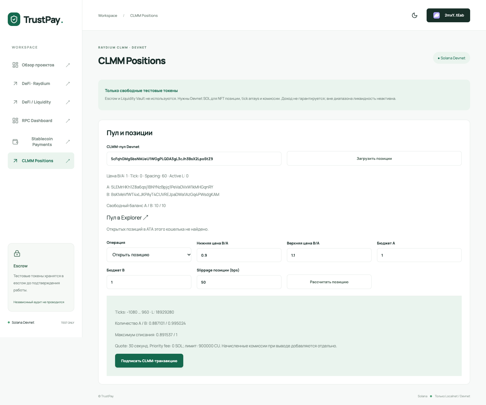
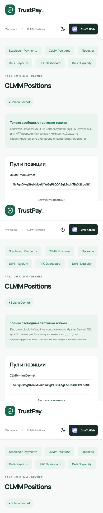

# Неделя 13 — Mock USD Payments и CLMM Positions

Реализованы платежи тестовым SPL-токеном и управление Raydium CLMM-позицией. Сеть — Solana Devnet. Контракты TrustPay и функции недель 8–12 сохранены.

**Ручная проверка новых операций в Phantom пока не выполнена. Неделя 13 не отмечается полностью проверенной.** Devnet lifecycle ниже выполнены программными тестовыми подписантами.

## Платежи

Mock USD — имитация stablecoin: не USDC, не RWA и не токен с резервным обеспечением. Цена не привязана к доллару. Mint: `5LEMrHKh1Z8a6qsj1BNYNzBpjq1PeVaDVxW1kMHGqnRY`, decimals: 6, freeze authority отсутствует.

Используется существующий SPL-escrow без миграции и повторного deploy. Раздел Stablecoin Payments проверяет mint, decimals, свободный ATA, баланс, роли и статус. Сам контракт сохраняет поддержку других classic SPL-токенов; отдельный раздел фильтрует платежи по Mock USD.

Создать и внести средства → исполнитель сдаёт работу → заказчик выплачивает. Для отмены исполнитель согласует её до сдачи, затем заказчик возвращает токены. Проверены повторные операции, чужая роль, refund без согласия и точные балансы. Четыре отрицательных сценария Devnet-скрипта отклоняются до подписи; проверки доступа самого контракта входят в Anchor-регрессии. Название записывается публично on-chain; арбитража, таймаута и автоматического возврата нет.

| Операция | Транзакция Devnet |
| --- | --- |
| deposit payment | [Explorer](https://explorer.solana.com/tx/4vLDGeoenRmzXCrxgif6ceDhEhnwT3b92jCLPmkSahY8NUswVBE88M65hRxWW3t1BkNftzYCDKTFLKnJJx6WJYkW?cluster=devnet) |
| submit work | [Explorer](https://explorer.solana.com/tx/5UEBSxADjiZPbvHAy9cxNfh3x8YktutcR5nna5moDVZFmUhGqj3dYvqinHZ6B1dEjuaozEVKp1Q6MnK72t7AtWLd?cluster=devnet) |
| release payment | [Explorer](https://explorer.solana.com/tx/HqHf9fGJD3sZZDEVTxwoni8dnDS4ii2kTq6CaJ1RXyb7semxs63mY6WgMwxqd8aRVNUzmX74txckYnt2gFhTgkz?cluster=devnet) |
| deposit refundable payment | [Explorer](https://explorer.solana.com/tx/5C6fd3ViXAN3dJ3m1pTejXxQ1Ck5prprE7zAG5dLwFGLCJQRcDEQuyzWMZDjzyonbGMpFhXGigH7kCCLWi8n6bGV?cluster=devnet) |
| allow cancellation | [Explorer](https://explorer.solana.com/tx/4nFKTeDAQypAQYZ9YzZ3dsw7FvrdKuGfDA5DCwZM1b5yN6KWBbdUcoPygcnZ41GoB1fBeutMEHZJq6CCLz17UzfC?cluster=devnet) |
| refund payment | [Explorer](https://explorer.solana.com/tx/W5T4UfLFiyqfWwzxpHhbxvkww7UiGzaqtbEyuUvrgJA5raroN1bdnyVwcehzJ2wEWUEpoEmHMdks5GjvgbcszGZ?cluster=devnet) |

[Платёжные доказательства](week13-payments-evidence.json).

## CLMM

SDK: `@raydium-io/raydium-sdk-v2@0.2.81-alpha`, официальные инструкции `ClmmInstrument`. Создан собственный CLMM-пул тестовой пары; CPMM не используется вместо CLMM.

| Параметр | Адрес |
| --- | --- |
| CLMM program | `DRayAUgENGQBKVaX8owNhgzkEDyoHTGVEGHVJT1E9pfH` |
| Пул | `5cFqhGMgSbsNMJeU1WGgPLQDA3gL3cJh3BsX2LpoStZ9` |
| Token A / Mock USD | `5LEMrHKh1Z8a6qsj1BNYNzBpjq1PeVaDVxW1kMHGqnRY` |
| Token B / Mock Asset | `BsKMeVfWT4xLJKPAyT4CUVREJpaDWa1AzGq4PWsdgKAM` |

Tick spacing — 60; начальная цена B/A — 1. UI читает текущую цену, tick и active liquidity из RPC. Диапазон выравнивается по spacing; увеличение использует точные ticks выбранной позиции. Количества рассчитываются SDK через Q64, maxima/minima — целыми числами с slippage.

Доступны открытие, просмотр, добавление ликвидности, частичный вывод, сбор комиссий и полный вывод с закрытием. NFT подтверждает владение позицией; новый NFT mint подписывается временным ключом, а Phantom — кошельком пользователя. Все подписи и содержание message проверяются существующим signing helper. Параметры до подписи: 900000 CU и 0 priority fee. Quote действует 30 секунд.

| Операция | Транзакция Devnet |
| --- | --- |
| open | [Explorer](https://explorer.solana.com/tx/3f8EThc9VMFheWcGK7bBMpDzA2SqnPWcNd3zv3SSuwgUoBdcQFo9fdogFrGVPos3MhuSAyj317e9iMq9Gsb61CgT?cluster=devnet) |
| increase | [Explorer](https://explorer.solana.com/tx/3Wst1XcrbcqN7BW5iJ3ZRkDyfaoVPTot6n6wPtSbam4dSfG5XbKiuTKD2P1kFRXmMqGWspZhcTbh6ufz1CyK3UY3?cluster=devnet) |
| collect fees | [Explorer](https://explorer.solana.com/tx/3Mg9awVWMbnpKjrHYFK3SodSuWyiMpn6bKddXDwL2GGuBfunz5Txnxde859zC8QgXv826CysVq6djBn8fy72Ehem?cluster=devnet) |
| decrease half | [Explorer](https://explorer.solana.com/tx/qNVeRfGQvEkTQEkPhnWt6Yr6EcVtBMXNp8DiqdMBkf3vXCo5as2E5RyvQ8c4pSwhCTu9Qa544z9SifDEqzmKiaM?cluster=devnet) |
| decrease all and close | [Explorer](https://explorer.solana.com/tx/fkqh8s63N57ReyDeC9j6piqcLynRqVVcZ5XzuGn7wvqQuKwiN61rSBecFmtLNniQZuQDVMhNvHAkgbuqJHicfe6?cluster=devnet) |

Открытая позиция имела L=189292960. Увеличение и уменьшение проверены чтением состояния. После закрытия personal position account отсутствует. Тестовый пул после полного вывода имеет active L=0; новая позиция может внести начальную ликвидность. Доходность не заявляется: торговля в пуле не генерировалась, проверка collection не доказывает положительный доход.

[CLMM lifecycle](week13-clmm-evidence.json) · [Создание mint/пула](week13-setup-evidence.json) · [12 finalized-транзакций, подписи, комиссии и token changes](week13-chain-verification.json).

## Безопасность и ограничения

Escrow и Liquidity Vault не являются источниками CLMM: расходуются только свободные ATA подписанта. Проверяются Devnet genesis, владельцы аккаунтов, pool/vault/position PDA, mint, NFT amount/supply/owner, frozen accounts, slippage и u64/u128. При изменении message, комиссий или прав аккаунтов после подписи отправка блокируется. Успех показывается только после подтверждения без ошибки; затем обновляются балансы и сетевая комиссия.

Управление рассчитано на standard CLMM, classic SPL assets и classic NFT позиции. Пулы с reward mint и Token-2022 позиции отклоняются. Оценка комиссий в UI показывает записанные `tokenFeesOwed`; ещё не записанные начисления определяются при обновлении позиции. При collection фактический результат отражается балансами/Explorer. Поиск ограничен первыми 100 NFT-кандидатами в ATA кошелька; доступен только выбранный пул. Независимый аудит не проводился.

## Проверки

| Команда / проверка | Результат |
| --- | --- |
| `npm run build` | Успешно; предупреждение Vite о размере chunks |
| `npx tsc --noEmit -p tsconfig.json` | Успешно |
| `npm run test:unit` | 44 passing |
| `npm run test:week13` | 11 passing |
| `anchor test --skip-build --skip-deploy --skip-local-validator` | 82 passing, 16 pending opt-in проверок |
| Security Lab | 12 отказов и разрешённый вывод; отдельный localnet |
| Escrow browser E2E | Localnet deposit/submit/release и cancel/refund, балансы и история |
| `npm run test:week13:browser` | Desktop/mobile 390 px, реальные RPC-ответы, запросы подписи отклонены QA provider; без отправки |
| Devnet scripts | Платёжные циклы и CLMM lifecycle подтверждены; balances проверены |
| `npm run verify:week13` | 12 finalized-транзакций проверены чтением RPC, новых транзакций нет |

16 pending — прежние opt-in Raydium local/Devnet, Vault Devnet и market RPC тесты; не считаются успешными. Localnet использовал существующий `trustpay.so`; Rust/IDL не менялись. [Security-регрессия](week13-security-regression.json), [повторная проверка swap недели 12](week13-swap-regression.json) и [browser evidence](week13-browser-evidence.json) сохранены отдельно от доказательств недель 8–12. Browser QA передаёт настоящие ответы Devnet RPC через Node и использует тестовый provider, не настоящее расширение Phantom.

## Файлы

`shared/payments.ts`, `positions.ts`, `transactions.ts`, `week13-config.ts`; `app/src/PaymentsPanel.tsx`, `PositionsPanel.tsx`, `week13-client.ts`, навигация App и стили; `scripts/week13-*.mjs`; `tests/week13.ts`, `browser-week13.mjs`; документация и публичные JSON-доказательства. Зависимости, адрес TrustPay и Rust-контракты не изменены.

## Запуск

```sh
npm ci
npm run dev -w app
npm run test:unit
npm run test:week13
npm run build
npm run test:week13:browser
npm run verify:week13
```

Открыть `http://127.0.0.1:5173`; Phantom — Solana Devnet. Разделы недели 13 используют `VITE_DEFI_RPC_URL` (по умолчанию официальный Devnet RPC), независимо от localnet escrow-конфигурации старых тестов.

`npm run setup:week13` требует существующий `.anchor/week09-wallet.json` и тестовые SOL. Настройка сохраняется по шагам и не пересоздаёт уже записанные mint/пул. Публичная конфигурация — `shared/week13-config.ts`. `test:week13:payments:devnet` и `test:week13:clmm:devnet` отправляют новые тестовые транзакции; для просмотра готовых результатов использовать read-only verifier. Ключи и временные ledgers остаются в игнорируемой `.anchor/`.

## Ручная проверка Phantom — ожидается

На прежний публичный адрес `2mxYEEpyuuo1msxRXGB4wWNqeCeaPSrcywcw2Qq7tEab` подготовлены 0,1 Devnet SOL и по 10 новых тестовых токенов. [Подготовительный перевод](week13-phantom-funding.json) не является ручной проверкой.

1. Обновить приложение и подключить этот Phantom Devnet-кошелёк. В Stablecoin Payments проверить Mock USD mint и баланс.
2. Для первого ручного платежа: название `Week13 Phantom`, количество 1, исполнитель `8uctBg6jVu2Y1bTKojWjn1K3dSkBGXGVRCxXPyF9DnMM` (проектный тестовый аккаунт). Нажать «Создать и внести средства», проверить запрос в Phantom и подтвердить **самостоятельно**. Передать публичную подпись для проверки и дальнейшего submit/release. Альтернатива — второй собственный Phantom-аккаунт исполнителя.
3. В CLMM Positions загрузить предзаполненный пул; выбрать «Открыть позицию», диапазон 0,9–1,1, бюджеты A=1/B=1, slippage 50 bps. Получить свежую quote; проверить maxima и свободные балансы, подписать в течение 30 секунд. Нужны тестовые SOL на rent NFT/позиции/tick arrays.
4. После подтверждения проверить NFT, ticks/L, балансы и Explorer. Затем доступны increase, decrease, collect и close с новой quote для каждого действия. Не изменять комиссию вручную в Phantom: изменение message отклоняется.
5. Ручные подписи/ошибки должны быть проверены отдельно. Пока их нет, ручное создание/управление позицией и полный ручной payment flow не отмечаются успешными. Seed-фраза и приватные ключи не требуются.

## Скриншоты




